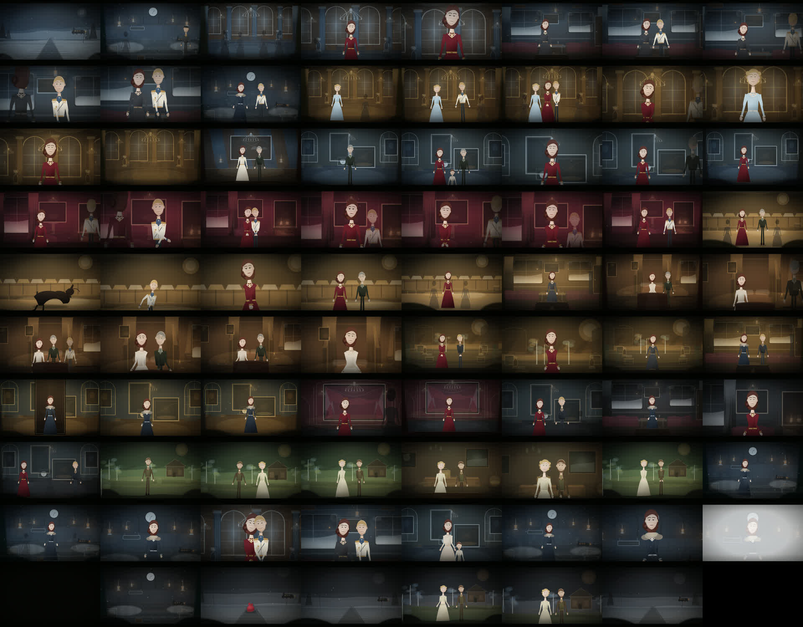
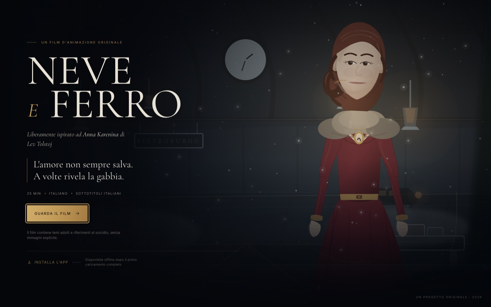
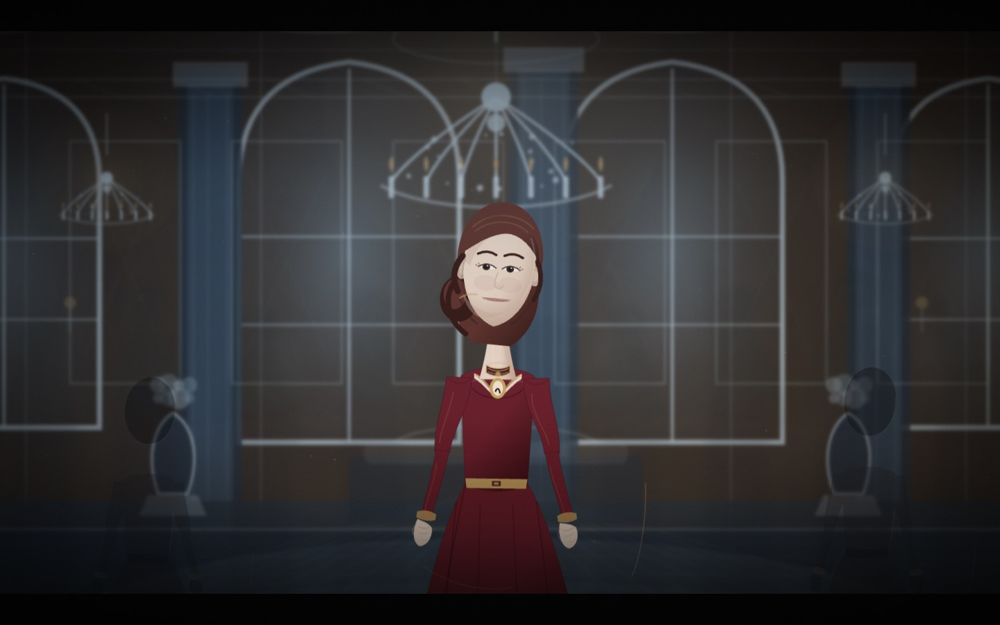
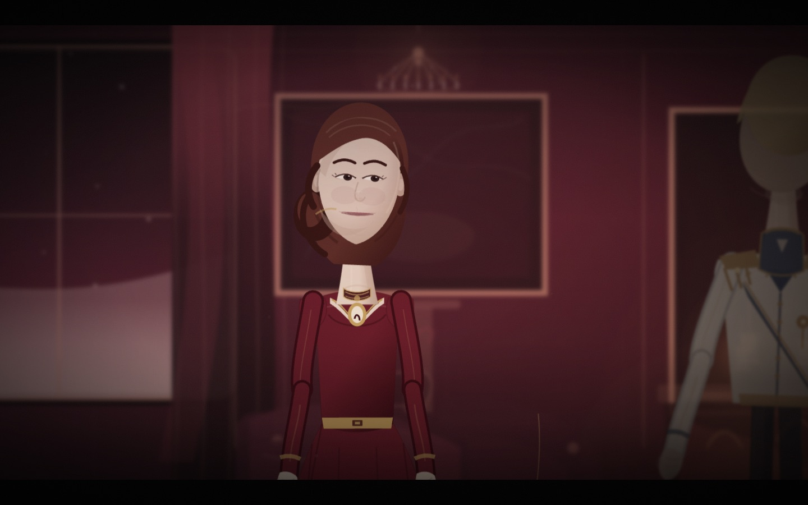
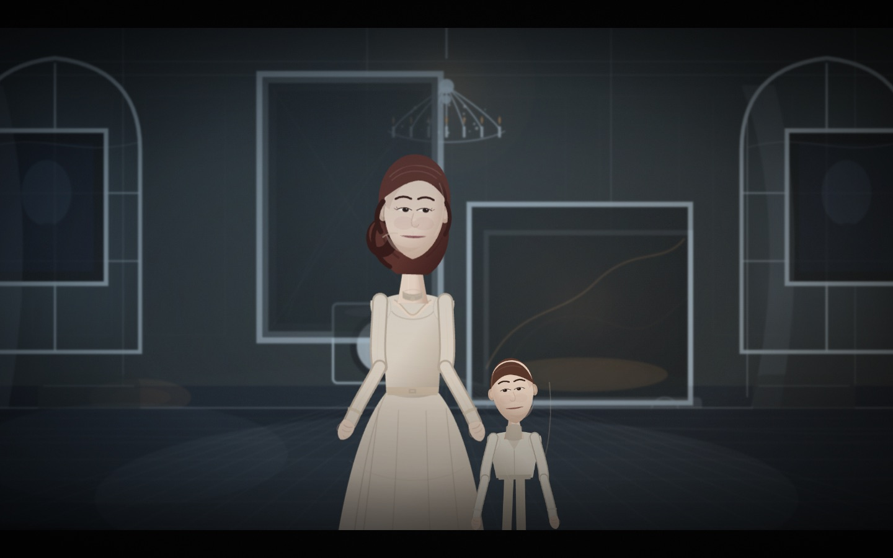

# NEVE E FERRO — QA

## Ambienti di verifica

- macOS, Node `22.23.2`, npm `10.9.8`.
- Simulazione CI Linux/Node `20.20.2` con `npm ci` pulito e build.
- Chrome locale via Playwright (`channel: chrome`).
- Build di produzione servita sotto `/random2/anna-karenina-film/`.
- Deploy live su GitHub Pages verificato su `https://lucagandolfi77.github.io/random2/anna-karenina-film/`.

## Matrice

| Verifica | Esito | Evidenza |
|---|---|---|
| `tsc --noEmit` | ✅ | nessun errore |
| Vitest | ✅ 13/13 | dati film, timeline, sottotitoli, persistenza |
| Playwright E2E | ✅ 7/7 | landing, player, pausa, seek, capitoli, sottotitoli, fine, resume, mobile, console |
| `npm ci` pulito | ✅ | Node 20.20.2 + Node 22 |
| Build Vite + SW | ✅ | 77 asset, base path annidato |
| 12 scene | ✅ | `src/data/film.ts`, test |
| Durata 1500 s | ✅ | test timeline e validazione |
| 79 inquadrature | ✅ | test e storyboard |
| 136 cue dialogo/pensiero/narrazione | ✅ | test e sceneggiatura |
| Nessuna scena vuota | ✅ | shot sweep 79/79, 0 frame sotto soglia di luminosità |
| Nessun errore console | ✅ | shot sweep + E2E |
| Pausa congela il tempo | ✅ | E2E |
| Ripresa senza desync | ✅ | E2E; AudioContext sospeso/ripreso |
| Seek e capitoli | ✅ | E2E |
| Sottotitoli on/off | ✅ | E2E |
| Resume da localStorage | ✅ | E2E |
| Layout mobile 390×844 | ✅ | E2E |
| Audio non silenzioso | ✅ | RMS dell'`AnalyserNode` > 0 in riproduzione |
| Manifest e icone | ✅ | live, nessun errore CDP |
| Service Worker scope | ✅ | `/random2/anna-karenina-film/` |
| Cache offline | ✅ | 77 asset live: index, JS, manifest, icone, font |
| Riproduzione offline | ✅ | landing + player sotto rete disattivata, anche live |
| Deploy GitHub Pages live | ✅ | workflow build + deploy verde |
| Passata integrale | ✅ | 25 min reali, fine raggiunta, 0 errori |
| Installazione iPhone/iPad reale | ⚠️ manuale | manifest valido; CDP segnala solo `in-incognito` |
| Missaggio audio soggettivo | ⚠️ non ascoltato in questa sede | verifica tecnica di livello, pausa e seek |
| Qualità visiva soggettiva | ⚠️ stile vettoriale dichiarato | non fotorealistico; fallback AI documentato |

## Shot sweep

79 screenshot, uno per inquadratura, con UI e sottotitoli nascosti, presi dalla build di produzione sotto il percorso GitHub Pages. Nessun errore, nessun frame vuoto.



Immagini chiave:






## Base path e offline

Comandi:

```bash
BASE_PATH=/random2/anna-karenina-film/ npm run build
npm run serve:pages
```

Risultati locali:

- manifest: `/random2/anna-karenina-film/manifest.webmanifest`
- scope service worker: `/random2/anna-karenina-film/`
- cache: 77 asset
- offline: landing e player avviati, tempo che avanza
- errori console: 0

## Passata integrale

`scripts/full-pass.ts` avvia il film dall'inizio, lo lascia scorrere a velocità reale e registra stato, scena, sottotitolo e audio ogni 15–60 secondi. La passata ha raggiunto la schermata finale dopo circa 25 minuti, senza errori né blocchi.

- Campioni registrati: 28
- Errori: 0
- Fine raggiunta: sì
- Log completo: [`full-pass.json`](qa/full-pass.json)

## Deploy live

- URL: **https://lucagandolfi77.github.io/random2/anna-karenina-film/**
- Workflow `.github/workflows/pages.yml`: build e deploy **verdi**.
- Step `Build NEVE E FERRO`: `npm ci`, typecheck, test e build eseguiti con successo in CI.
- Manifest live: HTTP 200, nessun errore di parsing.
- Service worker live: HTTP 200, scope `/random2/anna-karenina-film/`.
- Player live: riproduzione attiva, AudioContext `running`, livello audio > 0, 0 errori console.
- Offline live: 77 asset in cache; landing e player avviati senza rete.
- Installabilità: CDP non segnala errori di manifest; l'unico errore è `in-incognito` perché il test è headless. La prova su dispositivo iOS reale resta manuale.

Nota: il workflow **CI** del portfolio è rosso per il check preesistente `Every PWA index.html links its manifest`, relativo ad altri progetti del repository. Non è stato modificato. Il workflow **Pages** del film è verde.

## Limiti dichiarati

- Non è stata effettuata una prova su un iPhone/iPad fisico: l'installazione PWA e il fullscreen iOS richiedono un dispositivo reale.
- Il missaggio audio è verificato tecnicamente (RMS, contesto, pausa, seek, passata completa), non con un ascolto critico umano.
- La grafica è volutamente vettoriale/stilizzata; la generazione AI di matte painting non era disponibile e non è stata usata. Gli ambienti sono disegnati proceduralmente.
- La versione distribuita non include voci registrate: usa narrazione scritta, dialoghi sottotitolati e un voice pack predisposto.
