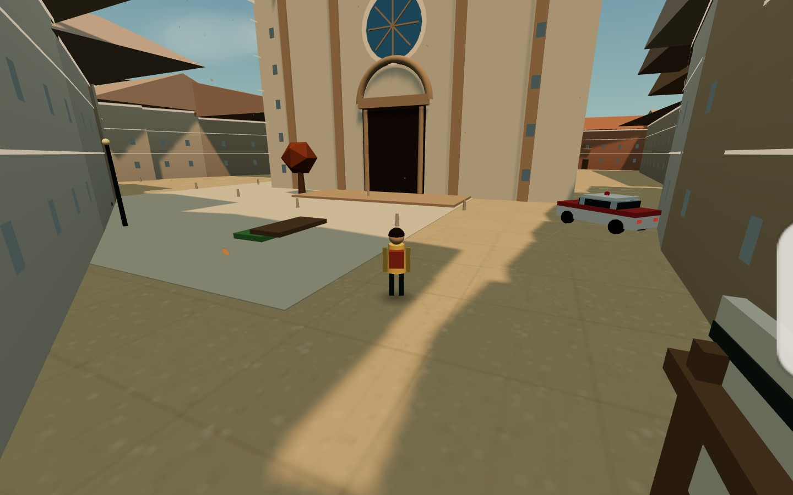

# Fidenza da Giocare v2.22



Open world gratuito nel browser ambientato a **Fidenza**, Emilia-Romagna. La
v2.22 rifinisce la periferia con **passaggi a livello**, **segnaletica dei
parcheggi** e **nomi delle vie sulla mappa 2D**. Restano i **parchi giocabili**,
i **campi sportivi**, i dettagli ferroviari e fluviali della v2.21, il **centro
storico vivo** della v2.20, il **Duomo solido** della v2.19, la mappa estesa con
**Coduro e il settimo quartiere** della v2.18, il **Visual Upgrade** della
v2.17, l’**Editor Pro** della v2.16, la **città viva** della v2.15 e il terreno
**AWS Terrain Tiles** della v2.14.

> Progetto indipendente e non ufficiale, non affiliato al Comune di Fidenza.
> Nessun codice, asset, testo o audio di altri giochi è stato riutilizzato.

## Indice

- [Avvio](#avvio)
- [Tecnologie usate](#tecnologie-usate)
- [Features](#features)
- [Come giocare](#come-giocare)
- [Comandi](#comandi)
- [Curiosità](#curiosità)
- [Novità v2.22](#novità-v222--passaggi-a-livello-e-mappa-2d)
- [Novità v2.21](#novità-v221--parchi-ferrovia-e-periferia)
- [Novità v2.20](#novità-v220--centro-storico-vivo)
- [Novità v2.19](#novità-v219--duomo-solido-con-palette-3d)
- [Novità v2.18](#novità-v218--coduro-e-mappa-estesa)
- [Novità precedenti](#novità-v217--visual-upgrade)
- [Dati, rigenerazione ed editor](#dati-e-correzioni)
- [Struttura del progetto](#struttura)
- [Licenze](#licenze)

## Avvio

Serve un server statico: i moduli ES e i dati JSON non funzionano aprendo
`index.html` con `file://`.

```bash
cd fidenza-city-v2
python3 -m http.server 8081
# apri http://localhost:8081
```

In alternativa:

```bash
npx serve fidenza-city-v2
```

Requisiti: un browser moderno con WebGL, JavaScript ES modules, Web Audio e
Service Worker. Non serve installare dipendenze: Three.js e i font sono
self-hosted in `vendor/` e `assets/fonts/`.

## Tecnologie usate

| Tecnologia | Dove viene usata |
| --- | --- |
| **HTML5 + CSS3** | Shell del gioco, HUD, dialoghi nativi `<dialog>`, layout responsive, `env(safe-area-inset-*)`, `backdrop-filter`. |
| **JavaScript ES2022 (moduli ES)** | Tutto il codice del gioco, import/export tra moduli, nessun bundler a runtime. |
| **Three.js r169** | Scena 3D, camera, materiali, luci, ombre, geometrie, `InstancedMesh`, `BufferGeometryUtils`. |
| **WebGL** | Rendering accelerato di città, veicoli, alberi, particelle e cielo. |
| **Post-processing custom** | Bloom, tone mapping, color grading, vignetta e DOF con render target HDR, senza addon esterni. |
| **Palette 3D → materiali** | Colori e texture procedurali del Duomo derivati dal modello 3D, senza splat a runtime. |
| **Layer OSM del centro** | Negozi, arredo urbano, alberi, barriere e segnaletica letti da `city.json`, con instancing e merge. |
| **Dettagli periferia** | Parchi, campi sportivi, passaggi a livello, parcheggi, ferrovia, argini e colture, con instancing e limiti per qualità. |
| **Canvas 2D** | Minimappa e mappa grande, texture procedurali, insegne delle attività, cattura foto. |
| **Web Audio API** | Audio interamente sintetizzato: motori, campanello bici, clacson, ambiente, eventi e segnali. |
| **Web Storage (`localStorage`)** | Salvataggio locale di nome, punti, stelle, luoghi, missioni, carriera, impostazioni e statistiche. |
| **IndexedDB** | Galleria fotografica locale con miniature e JPEG. |
| **Service Worker + Cache API** | PWA offline con precache di shell, dati, stili, font, Three.js e moduli. |
| **Web App Manifest** | Installazione su desktop e mobile, icona, tema e modalità standalone. |
| **Pointer Lock API** | Controllo camera con mouse su desktop. |
| **Gamepad API** | Controller con stick sinistro/destro e pulsanti. |
| **Vibration API** | Feedback aptico su mobile per interazioni, stelle e bici. |
| **`matchMedia` e pointer events** | Rilevamento touch, joystick virtuale, pulsanti a pressione continua. |
| **Fetch API + JSON** | Caricamento di `city.json`, `terrain.json`, `map.json`, stili e meteo. |
| **`Intl.DateTimeFormat`** | Ora italiana, giorni della settimana e orologio del mondo. |
| **File System Access API** | Salvataggio diretto dei manifest dall’editor di mappa. |
| **Node.js (script CLI)** | Rigenerazione città, terreno, import mappa, audit e validazione. |
| **Overpass API** | Pipeline offline per scaricare i dati OpenStreetMap di Fidenza. |
| **AWS Open Data Terrain Tiles** | Heightmap Terrarium zoom 15, griglia 512×512, con dati EU-DEM Copernicus per il rilievo fuori dal centro. |
| **OpenStreetMap (ODbL)** | Edifici, strade, piazze, parchi, corsi d’acqua, POI e attraversamenti. |
| **GitHub Pages** | Hosting statico della build pubblica. |

### Scelte tecniche

- **Nessun backend**: salvataggi, foto e progressi restano nel browser.
- **Nessun tile server a runtime**: la mappa 2D è disegnata una volta su canvas
  dai dati della città.
- **Geometrie unite per materiale**: muri, tetti, strade e arredi riducono le
  draw call.
- **Instancing** per alberi, lampioni, panchine, bollard, cespugli, ciuffi
  d’erba e fiori.
- **Collisioni 2D** cerchio-poligono con spatial hash.
- **Qualità adattiva**: risoluzione e dettagli cambiano su mobile e in base al
  carico.
- **Heightmap AWS**: il terreno usa i tile Terrarium AWS ad alta risoluzione,
  ricampionati in una griglia 512×512 e verificati con un audit dedicato.
- **Duomo solido**: colori e texture derivano dal modello 3D, ma il runtime usa
  solo mesh e materiali del gioco; lo splat compresso resta un sorgente offline
  e non entra nella PWA.
- **Centro storico vivo**: i micro-elementi OSM sono instanziati o uniti per
  materiale, con limiti per qualità, per non moltiplicare le draw call.
- **Periferia viva**: traverse, canneti, colture e arredo sportivo sono
  instanziati; i campi sportivi cercano rettangoli liberi da edifici e alberi.
- **Dati separati dal codice**: la città è editabile con manifest, schema,
  template e tool di validazione.
- **Quartieri Voronoi**: i confini dei sette macro-quartieri sono calcolati da
  semi nel manifest, così restano coerenti e modificabili senza ridisegnare
  poligoni a mano.

## Features

### Città e mondo

- **Fidenza ricostruita** da OpenStreetMap: **4.214 edifici**, **2.396 segmenti
  stradali**, **249 aree** (piazze, parchi, prato, sport, agricole),
  **33 corsi d’acqua** e **68 binari**.
- **101 punti di interesse OSM** con icone e categorie, oltre a **24 luoghi**
  scopribili e **12 landmark** modellati.
- **Sette quartieri**: Centro, Monica, San Lazzaro, Le Azalee, Corea, Luce e
  **Coduro**, con case, strade, parchi e filari provenienti dal nuovo bbox.
- **Altezze e facciate data-driven**: `height`, `building:levels`, stile rurale,
  industriale, urbano, storico o civico, colori e tetti OSM quando presenti.
- **51 insegne di attività** su ristoranti, bar, caffè, farmacie, banche, hotel
  e musei, montate sulla facciata più vicina.
- **Grafica PBR**: materiali con rugosità, normal map procedurali, acqua
  animata, asfalto bagnato, pozzanghere e usura stradale.
- **Post-processing**: bloom, tone mapping, color grading, vignetta e DOF nella
  modalità foto. Selettore qualità Auto/Bassa/Media/Alta.
- **Tetti 3D** a falde, padiglione e piano, con comignoli, abbaini, grondaie,
  cornici, persiane, balconi, gradini e vetrine.
- **Vegetazione viva**: fino a **1.000 alberi**, cespugli, ciuffi d’erba e fiori
  distribuiti su parchi e prato.
- **Quattro stagioni** con palette, particelle, nebbia, neve, luci natalizie e
  meteo; **ciclo giorno/notte** con finestre illuminate e lampioni.
- **Strade realistiche** con asfalto procedurale, marciapiedi, linee, tombini,
  attraversamenti e **7 semafori** funzionanti.
- **Vita urbana**: pedoni, ciclisti, auto ambientali, navetta, treno e bici
  parcheggiate.

### Abitanti e dialoghi

- **Fino a 19 abitanti con dialoghi originali**: 13 fissi in piazze, parchi,
  stazione, teatro, Gran Madre, farmacia e Bar Blu Piramide, più 6 camminanti.
- **Fino a 30 pedoni camminanti** su marciapiedi, vie pedonali e sentieri, con
  qualità bassa/media/alta.
- **Icona 💬** sopra gli abitanti non ancora incontrati, visibile quando ti
  avvicini.
- Dialogo con nome, ruolo, zona, 2–3 battute e un consiglio pratico.
- **Primo incontro**: +25 punti, registrazione negli incontri e 2 nuovi
  achievement dedicati.
- Gli NPC fissi si girano verso il giocatore quando si avvicina.

### Quartieri e Bar Blu Piramide

- **Sei macro-quartieri** con confini Voronoi editabili: **Centro, Monica,
  San Lazzaro, Le Azalee, Corea e Luce**.
- HUD con il nome del quartiere, mappa grande con aree colorate ed etichette.
- Primo ingresso in un quartiere: **+50 punti**, scheda descrittiva e
  registrazione in `districtsSeen`.
- Nuovo achievement **Sei quartieri**, oggi **Sette quartieri** con Coduro, per averli visitati tutti.
- **Bar Blu Piramide** in Via Ferraris 14, nel quartiere Le Azalee: insegna blu,
  terrazza, tavolini, ombrelloni, auto parcheggiate e la barista **Blue**.
- Il bar è un punto di ritrovo narrativo: qui si raccolgono storie e consigli
  sui quartieri.
- **Ritmi di città**: di notte pedoni e ciclisti ambientali si diradano, mentre
  le insegne e le luci del Bar Blu restano accese.

### Diario di Fidenza

- **Gazzetta di Fidenza** con prima pagina, cronaca, annunci economici e
  notizie generate dallo stato del gioco.
- **Passaporto del Pellegrino** con sei timbri di quartiere.
- **Radio Francigena** con frequenza, storia del quartiere e notiziario.
- **Taccuino** con quartieri, abitanti incontrati, stelle, luoghi, foto,
  achievement, carriera e tempo di gioco.
- Accesso dal menu pausa, con interfaccia dedicata e contenuti sempre locali.

### Città viva

- **Turni degli NPC**: lavoro, pausa pranzo, tempo libero e casa.
- **Presenze anti-pop**: i cambi di turno avvengono solo quando il giocatore è
  abbastanza lontano.
- **Bar Blu Piramide**: aperto 8:00–20:00, domenica chiuso; neon e luce seguono
  l’orario.
- **Bar Nuovo** (7:00–22:00), **Bar Diana** (7:00–23:00) e **La Strega**
  (18:00–01:00) con tavolini, luci e avventori serali.
- **Folle per quartiere**: Monica si riempie all’ora di punta, il Centro a
  pranzo e la sera, i quartieri residenziali al mattino e nel tardo pomeriggio.
- **Notte**: pedoni e ciclisti ambientali si diradano; restano solo i turni
  notturni.
- **Eventi**: mercato, teatro, stazione e San Donnino sovrascrivono i turni
  normali.

### Mobilità

- **Auto, Vespa, taxi e ambulanza** guidabili con fisica arcade, collisioni,
  ruote animate, clacson e potenziamenti.
- **10 bici guidabili** in centro, piazze e parchi, con campanello, ruote e
  pedalata animata. Le bici parcheggiate arrivano a **18/24/30** secondo la
  qualità; i ciclisti animati completano il quadro.
- **Navetta urbana** con percorso calcolato sulla rete stradale, 4 fermate,
  pensiline e cartelli.
- **Treno** a tre carrozze con sosta in banchina.
- **Volo libero** con WASD/joystick, quota, boost, atterraggio e camera ampia.
- **Traffico ambientale** solo su strade `primary`, `secondary` e `tertiary`:
  12 auto su qualità bassa, 20 su media, 30 su alta. Le strade pedonali,
  ciclabili, di servizio e residenziali restano libere.
- **Semafori** con ciclo rosso/giallo/verde: le auto rallentano e si fermano,
  i pedoni attraversano sulle strisce.
- **Strade rinnovate**: asfalto procedurale con graniglia, crepe, rattoppi e
  macchie; cordoli, marciapiedi rialzati, linee di bordo e mezzeria.
- **Pedonali e piazze** con pavimentazioni in lastre, porfido e pattern
  dedicati per quartiere.
- **Bar Blu Piramide** con terrazza e arredi urbani dedicati.

### Missioni e carriera

- **14 missioni** guidate dal manifest: emergenza al parco, inseguimento,
  pizza in Vespa, taxi, cartoline, pellegrino, consegna urgente, giro turistico,
  coincidenza, ultimo treno, capolinea e tre missioni di San Donnino.
- **Fidenza Carriera**: patente con tre checkpoint, tre professioni (tassista,
  corriere, fotografo), lavori generati dai POI, XP, livelli, soldi,
  reputazione, bonus notturni e storico.
- **Garage** con potenziamenti reali per motore, assetto e freni.
- **Lavori fotografici** che richiedono una vera foto in modalità foto vicino
  al soggetto.
- **Eventi della città**: mercato del mercoledì e del sabato, mercatino di
  Natale, festa di San Donnino, serate al Teatro Magnani, dehors estivi e ora
  di punta in stazione.
- **San Donnino**: processione, bancarelle, torta fritta, culatello, gnocco
  fritto, programma della festa, fuochi d’artificio e badge dedicato.

### Foto, progressi e rigiocabilità

- **Modalità foto** con camera libera, filtri, cornici, griglia, ora e stagione
  di anteprima, nascondi giocatore/veicoli, scatto JPEG, galleria IndexedDB e
  download PNG.
- **27 stelle** nascoste e **24 luoghi** da scoprire.
- **40 achievement** e statistiche dettagliate: km a piedi e in auto, velocità
  massima, missioni, stelle, luoghi, foto, stagioni, giorni e tempo di gioco.
- **Sfida del giorno** deterministica dalla data, con progresso e ricompensa
  salvati solo in locale.
- **Punteggio**, badge evento, storico lavori e replay libero dopo l’intro.

### Mobile e PWA

- **Joystick virtuale** che funziona a piedi, in auto, in Vespa, in bici e in
  volo.
- **Menu rapido touch** con pausa, mappa, missioni, carriera, foto, volo, bici
  e audio.
- **Pulsanti contestuali** per interagire, frenare, clacson e azione.
- **Volo mobile** con joystick per il movimento e pulsanti **▲ Sali** /
  **▼ Scendi** per la quota.
- **Pulsante 🚲 Bici**: sale sulla bici più vicina entro 8 m, scende se sei in
  sella, avvisa se sei su un altro veicolo o indica la distanza della bici più
  vicina.
- **Bici sulla minimappa e sulla mappa grande**.
- **HUD adattivo**, risoluzione dinamica, ombre ridotte e dettagli contenuti su
  mobile.
- **PWA installabile e offline** con cache versionata e avviso di aggiornamento.

### Editor e dati

- **Editor Pro**: scorciatoie PC, command palette, multi-tab geometrici e
  modifica vertice per vertice.
- **Geometrie custom**: nuove strade, aree, edifici, corsi d’acqua e ferrovie
  salvate in `map.custom` e visibili in 3D, minimappa e mappa grande.
- **Mission builder** con tappe, tempo, reward, POI collegato, commenti e foto.
- **Undo/redo**, snap, layer, ricerca, duplicazione, nudge e validazione
  geometrica integrata.
- **Prestazioni**: spatial hash, culling, rendering in rAF e validazione
  rimandata al rilascio del drag.
- **Salvataggio** con File System Access API, download/import JSON e bozza in
  `localStorage`.
- **Audit e validatori**: POI, edifici, insegne, traffico e raggiungibilità.

## Come giocare

### 1. Primo avvio

1. Avvia il server statico e apri `http://localhost:8081`.
2. Scegli la stagione (o lascia “automatica”).
3. Premi **Gioca** e, se vuoi, inserisci il tuo nome.
4. Ti trovi in Piazza Duomo, davanti alla facciata del Duomo di San Donnino.

### 2. Muoversi e guardarsi intorno

- **Desktop**: WASD o frecce per muoverti, mouse per guardare, Shift per
  correre.
- **Mobile**: joystick sinistro per muoverti, trascina sul canvas per guardare.
- **Controller**: stick sinistro per muoverti, stick destro per guardare.
- Avvicinati a un luogo, a una stella o a un veicolo e usa **E** (o il pulsante
  azione) per interagire.
- Apri la **mappa** con **N** o tocca la minimappa per vedere POI, stelle,
  missioni, bus, treno e bici.

### 3. Esplorare e collezionare

- Cerca le **27 stelle**: brillano in aria e si raccolgono passandoci vicino.
- Scopri i **24 luoghi**: avvicinati al beacon e interagisci.
- Ogni stella e ogni luogo danno punti; i punti sbloccano achievement e
  compaiono nella sfida del giorno.
- La minimappa mostra stelle, luoghi, missione attiva, eventi e bici.
- Attraversa i **sette macro-quartieri**: Centro, Monica, San Lazzaro, Le Azalee,
  Corea, Luce e Coduro. Al primo ingresso ricevi +50 punti e una scheda del quartiere.
- Fermati al **Bar Blu Piramide**, in Le Azalee: la barista Blue ha storie e
  consigli sui dintorni.

### 4. Diario di Fidenza

- Apri il **Diario di Fidenza** dal menu pausa.
- **Gazzetta**: prima pagina e annunci generati da quartieri, meteo, eventi,
  statistiche e incontri.
- **Passaporto**: i sei timbri dei quartieri; si riempie visitando la città.
- **Radio Francigena**: storia del quartiere e notiziario, con jingle.
- **Taccuino**: riepilogo di quartieri, abitanti, stelle, luoghi, foto,
  achievement, carriera e tempo di gioco.

### 5. Orari e locali

- Il Bar Blu Piramide è aperto **8:00–20:00**, domenica chiuso.
- Bar Nuovo, Bar Diana e La Strega hanno orari e tavolini esterni.
- Quando un locale è chiuso, luci e arredi si spengono.
- Gli NPC seguono turni: lavoro, pausa, tempo libero e casa.
- Se ti avvicini a un NPC al cambio turno, resta lì finché non ti allontani:
  niente apparizioni o sparizioni improvvise.
- La sera i locali si riempiono di avventori e il Centro prende vita.
- Il Diario di Fidenza mostra **Aperti ora** e i turni del giorno.

### 6. Parla con gli abitanti

- Avvicinati a una persona con l’icona **💬** sopra la testa.
- Premi **E** su desktop o tocca il pulsante **💬** su mobile.
- Leggi la battuta, poi usa **Parla ancora** per sentire le altre frasi.
- Alcuni abitanti danno consigli su volo, foto, bici, missioni ed eventi.
- Al primo incontro guadagni **25 punti** e sblocchi i due achievement degli
  incontri.
- Se saluti e torni più tardi, l’abitante ti riconosce e può raccontarti di
  nuovo le sue storie.

### 7. Guidare auto, Vespa e bici

- Avvicinati a un veicolo e premi **E** (o il pulsante azione).
- **W/joystick su** accelera, **S/joystick giù** frena o va in retromarcia,
  **A/D o joystick laterale** sterza.
- **Spazio/Freno** frena, **H/📯** suona il clacson.
- **E** scende dal veicolo.
- Su mobile puoi usare il pulsante **🚲 Bici** in qualsiasi momento:
  - se sei in sella, scendi;
  - se sei a piedi e c’è una bici entro 8 m, sali;
  - se sei su un altro veicolo, il gioco ti chiede di scendere;
  - altrimenti ti dice a quanti metri è la bici più vicina.
- Le bici guidabili sono segnate in oro sulla mappa.

### 8. Volare

- Premi **V** (desktop) o **✈** nel menu rapido (mobile).
- **WASD/joystick** muove in orizzontale e in avanti, **Space/Q** o **▲/▼**
  regola la quota, **Shift** dà il boost.
- Guarda in alto o in basso con il mouse/dito per salire o scendere in volo.
- Premi **V** o **✈** per atterrare.
- Non puoi volare mentre sei su un veicolo: prima scendi.

### 9. Missioni

1. Apri il menu missioni con **F** o **☑**.
2. Scegli una missione e segui il beacon sulla mappa.
3. Raggiungi le tappe nell’ordine indicato e interagisci con **E**.
4. Completa la missione entro il tempo per ottenere punti e, se previsto,
   ricompense di carriera.

### 10. Carriera

1. Apri **Carriera** con **C** o **▤**.
2. Sostieni l’esame di guida: tre checkpoint da raggiungere.
3. Accetta lavori come tassista, corriere o fotografo.
4. Guadagna XP, soldi e reputazione; sali di livello.
5. Compra potenziamenti nel garage: motore, assetto e freni.
6. I lavori fotografici richiedono una foto scattata vicino al soggetto.

### 11. Modalità foto

- Premi **P** o **▣**.
- Muoviti con WASD, guarda con il mouse, regola l’altezza con Q/E, cambia FOV
  con `[` e `]`.
- Scegli filtro, cornice, ora e stagione.
- Attiva o disattiva griglia, giocatore e veicoli.
- Scatta: la foto viene salvata in **IndexedDB** e compare nella galleria.
- Puoi scaricarla in PNG o eliminarla; tutto resta locale.

### 12. Eventi e sfida del giorno

- La card **“Oggi in città”** mostra l’evento attivo e il prossimo.
- Partecipa agli eventi per statistiche, achievement e lavori speciali.
- La **sfida del giorno** cambia ogni giorno ed è deterministica dalla data.
- La festa di San Donnino ha tre missioni dedicate e un badge.

### 13. Salvataggio e PWA

- Il progresso è salvato automaticamente in `localStorage`.
- Dal menu pausa puoi esportare/importare il salvataggio o azzerare i progressi.
- La PWA funziona offline dopo il primo caricamento.
- Se modifichi file statici, incrementa `CACHE` in `sw.js` per invalidare la
  cache.

## Comandi

| Azione | Desktop | Mobile |
| --- | --- | --- |
| Muoversi | WASD / frecce | joystick sinistro |
| Correre | Shift | pulsante Corri |
| Guardare | mouse (pointer lock) | trascina sul canvas |
| Interagire | E | pulsante azione contestuale |
| Parlare con un abitante | E vicino a 💬 | pulsante azione 💬 |
| Entrare/uscire dal veicolo | E vicino al veicolo | pulsante azione |
| Bici | E vicino alla bici | pulsante 🚲 |
| Accelerare | W / ↑ | joystick su |
| Freno / retromarcia | S / ↓, Spazio | joystick giù, pulsante Freno |
| Sterzare | A/D o ←/→ | joystick laterale |
| Clacson / campanello | H | pulsante 📯 |
| Volare | V | pulsante ✈ |
| Quota in volo | Space / Q | pulsanti ▲ Sali / ▼ Scendi |
| Boost in volo | Shift | — |
| Atterrare | V | pulsante ✈ |
| Missioni | F | menu rapido touch |
| Carriera | C o voce in pausa | menu rapido touch |
| Diario di Fidenza | voce in pausa | menu pausa |
| Mappa | N o click sulla minimappa | menu rapido touch |
| Modalità foto | P o voce in pausa | menu rapido touch |
| Audio | M | menu rapido touch |
| Stagione | selettore in pausa o nell’intro | selettore |
| Pausa | Esc | Esc |

Nota: i controlli laterali sono invertiti in tutte le modalità di movimento
(a piedi, in auto e in volo): **A/←** va a destra, **D/→** va a sinistra.

Nella modalità foto: WASD per muoverti, trascina il mouse per guardare, Q/E per
l’altezza, Shift per andare veloce, `[` e `]` per il campo visivo, P/Esc per
uscire. La galleria e i download sono solo locali. Su mobile compare uno stick
virtuale per muovere la camera.

**Controller**: stick sinistro per muoversi, stick destro per guardare, A per
interagire, B per frenare, X per correre, Y per le missioni, Back per la mappa,
Start per la pausa.

**Performance**: aggiungi `?quality=low`, `?quality=medium` o `?quality=high`
all’URL per forzare il livello grafico.

## Curiosità

- **Fidenza** si chiamava **Borgo San Donnino** e sorge lungo la **Via
  Francigena**, l’antica rotta dei pellegrini verso Roma. Nel gioco la missione
  *Il pellegrino* rende omaggio a questo cammino.
- Il **Duomo di San Donnino** è uno dei simboli romanici dell’Emilia-Romagna:
  la facciata è incompleta e conserva sculture e bassorilievi. Nel gioco è
  modellata con la facciata rivolta verso Piazza Duomo.
- **San Donnino** è il patrono di Fidenza; la festa patronale nel gioco include
  processione, bancarelle, torta fritta, culatello e gnocco fritto.
- Il **Teatro Girolamo Magnani** porta il nome di un celebre scenografo
  fidentino. Nel gioco ospita serate ed eventi speciali.
- La **Stazione di Fidenza** è un nodo ferroviario della pianura parmense; nel
  gioco è ricostruita con binari, banchina, pensilina e tabellone.
- Il **torrente Stirone** attraversa la zona e dà il nome al parco regionale;
  nel gioco è trattato come corso d’acqua lineare, non come punto.
- **Piazza Duomo** non è l’obelisco: l’obelisco è un POI separato in Piazza
  Garibaldi. È una delle correzioni storiche rispetto alla v1.
- La mappa usa **4.214 edifici** con footprint reali: i tetti non sono più
  generati sul bounding box ma sulla forma dell’edificio.
- Le **51 insegne** delle attività sono associate al POI commerciale e montate
  sulla facciata più vicina, evitando sovrapposizioni.
- Il traffico ambientale è **solo su strade carrabili principali**: niente auto
  su pedonali, ciclabili, marciapiedi o strade residenziali.
- La città ha **7 semafori** e **307 attraversamenti OSM**; i pedoni attraversano
  quando le auto hanno il rosso.
- Gli **abitanti** hanno nomi e battute originali: Giulia al Duomo, Chiara in
  stazione, Bianca al parco, Nadia in farmacia e molti altri.
- I **sette macro-quartieri** usano confini Voronoi calcolati dai semi nel
  manifest: niente poligoni disegnati a mano, ma confini coerenti e modificabili.
- Il **Bar Blu Piramide** è ispirato al locale di Via Ferraris 14: nel gioco ha
  terrazza, insegna blu e la barista Blue.
- Il Bar Blu Piramide segue un orario realistico: **8:00–20:00**, domenica
  chiuso. Di notte il neon si spegne.
- **Bar Nuovo**, **Bar Diana** e **La Strega** hanno orari diversi: il quartiere
  cambia volto a seconda dell’ora.
- Gli NPC non si teletrasportano davanti al giocatore: i cambi di turno restano
  in attesa finché non ti allontani.
- La **Gazzetta di Fidenza** non usa un server: titoli e annunci vengono
  composti nel browser a partire dai tuoi progressi.
- Il **Passaporto** trasforma i sette quartieri in timbri da collezionare.
- Il terreno usa i **Terrain Tiles AWS** in formato Terrarium: ogni pixel
  contiene una quota, non un colore.
- La heightmap è una griglia **512×512** a zoom 15, ricampionata con
  interpolazione bilineare per evitare scalini.
- Le **bici guidabili** sono 10 e le parcheggiate fino a 30: il centro si
  attraversa volentieri a pedali.
- Le **27 stelle** e i **24 luoghi** sono posizionati sul manifest e validati
  con un controllo di raggiungibilità.
- I **40 achievement** coprono stelle, luoghi, missioni, guida, foto, NPC,
  quartieri, stagioni, carriera, eventi e San Donnino.
- L’audio è **completamente sintetizzato** con la Web Audio API: non ci sono
  file audio registrati.
- Le foto sono salvate in **IndexedDB** e non vengono mai caricate su un server.
- Il gioco non ha **backend, account o telemetria**: tutto resta nel browser.
- La base della mappa 2D è disegnata **una sola volta** su un canvas offscreen
  da 2048 px, poi ritagliata per minimappa e mappa grande; nomi delle vie e
  parcheggi sono sovrapposti in tempo reale solo sulla mappa grande.
- La qualità grafica è adattiva: su mobile le ombre sono disattivate e la
  risoluzione si abbassa automaticamente se il frame rate cala.

## Novità v2.22 — Passaggi a livello e mappa 2D

- **Passaggi a livello**: 6 incroci tra strada e ferrovia con piano di
  attraversamento, assi, strisce bianche, barriere alzate a strisce rosse e
  bianche, croci di Sant’Andrea e luci rosse lampeggianti.
- **Segnaletica dei parcheggi**: insegne blu con la **P** in 16 parcheggi in
  qualità alta (10 media, 6 bassa), orientate verso la strada più vicina.
- **Mappa 2D**: nomi delle vie disegnati lungo le strade, con priorità per le
  vie principali e comparsa progressiva allo zoom; icona **P** sui parcheggi e
  nomi dei parcheggi principali.
- **Legenda**: aggiunta la voce **parcheggi** alla mappa grande.
- **Prestazioni**: barriere e insegne sono mesh leggere, i parcheggi sono
  filtrati per area e i nomi delle vie sono limitati e culling per viewport.
- **PWA**: cache **v2.22.0**.

## Novità v2.21 — Parchi, ferrovia e periferia

- **Parchi giocabili**: 4 playground in alta qualità (3 media, 2 bassa) con
  altalene, scivoli, sabbiera e panchine.
- **Impianti sportivi**: fino a 12 campi in alta qualità (8 media, 4 bassa) con
  porte da calcio, linee di campo, canestri e campi da basket.
- **Ferrovia più realistica**: 7.000 traverse, catenarie con pali e fili e
  segnali ferroviari sulle linee principali.
- **Stazione**: strisce tattili di banchina, taxi, rastrelliera bici e orologio.
- **Fiume Stirone**: 1.000 canneti e 200 sassi lungo gli argini; ringhiere sul
  Ponte Romano.
- **Periferia**: 2.400 file di colture nei campi e container nelle zone
  industriali.
- **Prestazioni**: dettagli instanziati e limitati per qualità, senza nuovi file
  dati.
- **PWA**: cache **v2.21.0**.

## Novità v2.20 — Centro storico vivo

- **67 negozi OSM** con vetrina al piano terra, insegna, tenda e categoria
  (abbigliamento, ottica, profumeria, panificio, supermercato e altre).
- **Arredo urbano reale**: 41 panchine, 27 cestini, 26 fermate bus con 4
  pensiline, 4 rastrelliere bici, 6 fontanelle/fontane, 3 isole ecologiche,
  11 dissuasori e 3 lampioni OSM.
- **120 alberi singoli OSM** e **46 barriere** tra muri, recinzioni e siepi.
- **Segnaletica stradale**: 46 segni stop/dare precedenza, linee di arresto e
  segnaletica orizzontale ai semafori.
- **72 lampioni del centro** (qualità alta, 48 media, 28 bassa) con pozze di
  luce notturne lungo Via Cavour, Via Berenini e le vie pedonali.
- **Tavolini e ombrelloni** per bar e caffè del centro, oltre alle quattro
  venue già esistenti.
- **Prestazioni**: arredo instanziato, vetrine/cornici/tende unite, limiti di
  negozi e lampioni per qualità.
- **Dati**: `tools/build-center-details.mjs` aggiunge i dettagli del centro a
  `data/city.json` senza rigenerare edifici, strade o aree.
- **PWA**: cache **v2.20.0**; il nuovo `city.json` pesa circa **2,37 MB**.

## Novità v2.19 — Duomo solido con palette 3D

- **Duomo solido in stile gioco**: il landmark è una mesh low-poly completa,
  senza nuvola di punti e senza puntini.
- **Colori dal modello 3D**: palette lit e texture procedurali (pietra, mattoni,
  coppi) derivate dal modello 3D fornito per il progetto.
- **Facciata in pietra e mattoni**, portale, rosone, lesene, torri e campanile
  restano geometria low-poly coerente con il resto della città.
- **Tutte le qualità**: il Duomo solido è sempre visibile, anche su mobile.
- **PWA più leggera**: `duomo-hd.bin` e `duomo-hd.json` non vengono più caricati
  né precachati; il binario splat (5,21 MB) resta nel repository come sorgente
  di colore. Il PLY originale resta locale e ignorato.
- **Fix edifici landmark**: finestre e persiane del building OSM del Duomo non
  vengono più generate sotto il landmark modellato.
- **Rigenerazione sorgente**: `node tools/build-duomo-splat.mjs`; dettagli in
  `assets/3d/README.md`.

## Novità v2.18 — Coduro e mappa estesa

- **Nuovo bbox** a est/sud-est: include Coduro, Via Coduro, Via Emilia Est,
  Tangenziale e la zona artigianale.
- **Coduro è il settimo quartiere**, con seed Voronoi, descrizione, timbro nel
  Passaporto e achievement aggiornato.
- **Mappa più grande**: 4.214 edifici, 2.396 strade, 249 aree, 33 corsi d’acqua
  e 68 binari.
- **Altezze più precise**: parsing di `height` e `building:levels`, inferenza
  per case rurali, villette, appartamenti, capannoni e edifici civici.
- **Facciate data-driven**: stile rurale, urbano, industriale, storico o civico;
  finestre e persiane distribuite in base ai piani reali.
- **Parchi e verde OSM**: nuove aree `park`, `grass`, `farmland`, `sport`,
  `village_green`, `recreation_ground`, `dog_park` e filari alberati.
- **Strade più precise**: larghezza reale, corsie, limite di velocità,
  superficie, marciapiedi, piste ciclabili, ponti e gallerie.
- **Nuovo audit altezze** in `data/building-height-audit.json`.
- **Audit quartieri** aggiornato a sette quartieri.

## Novità v2.17 — Visual Upgrade

- **Post-processing** con bloom su neon, finestre, lampioni e fari; color
  grading, vignetta e tone mapping ACES.
- **Materiali PBR** su strade, marciapiedi, piazze, tetti, edifici, landmark,
  acqua e veicoli.
- **Normal map procedurali** per asfalto, cemento, pavimentazione, piazze e
  coppi, generate offline dal rilievo delle texture.
- **Acqua animata** con normal map in movimento, riflessi solari e trasparenza.
- **Strade bagnate**: rugosità e colore cambiano con la pioggia; compaiono
  pozzanghere e usura stradale.
- **Cielo migliorato** con alone solare, gradiente più profondo e nuvole.
- **Vento sugli alberi** con shader procedurale leggero.
- **Veicoli più curati**: cerchi con razze, specchi, targhe, fari emissivi e
  SpotLight reale per l’auto guidata; stop più luminosi in frenata.
- **Abitanti più curati**: volti, occhi, sciarpe, borse, cappelli e berretti,
  con gesti idle quando sono fermi.
- **Modalità foto** con DOF reale, bloom e cattura attraverso la pipeline
  post-processing.
- **Selettore qualità** Auto/Bassa/Media/Alta nel menu pausa.
- **Fix**: l’ora della modalità foto non viene più sovrascritta dall’orologio
  reale.

## Novità v2.16 — Editor Pro

- **Scorciatoie complete**: `V/H/R/A/B/W/T/P/S/G/F`, `Ctrl+Z/Y`, `Ctrl+S`,
  `Ctrl+Shift+S`, `Ctrl+O`, `Ctrl+D`, `Ctrl+K`, `Delete`, frecce, `+/-/0`,
  `1…9`, `?` e `Esc`.
- **Command palette** `Ctrl+K` per comandi ed entità.
- **Pannello scorciatoie** con `?` o `F1`.
- **Vertici modificabili** su edifici, strade, aree, acqua e ferrovie OSM.
- **Alt+clic** inserisce un vertice, `Delete` rimuove quello attivo,
  **Inverti** e **Semplifica** trasformano la geometria.
- **Disegno di nuove feature**: strada, area, edificio, corso d’acqua e
  ferrovia, con chiusura a doppio clic, `Invio` o click sul primo punto.
- **Modello `map.custom`** con `buildings`, `roads`, `areas`, `waterways` e
  `railways`.
- **Override assoluti** `pts`/`poly` per modificare le feature OSM senza
  rigenerare la città.
- **Edifici**: altezza, piani, tetto, colore. **Strade**: larghezza, tipo,
  superficie, senso unico, marciapiede, ponte e tunnel.
- **Acqua e ferrovie**: tipo, larghezza, visibilità e spostamento.
- **Duplicazione** (`Ctrl+D`), spostamento con frecce (1 m / 10 m) e rotazione
  (`Alt+←/→`, `,`/`.`).
- **Prestazioni**: spatial hash, culling, rendering in `requestAnimationFrame`,
  drag senza validazione completa e indice ricostruito solo al bisogno.
- **Validazione geometrica**: vertici duplicati, poligoni auto-intersecanti,
  feature troppo piccole, ID duplicati e override assoluti non validi.
- **Gioco 3D e minimappa** aggiornati per colori, larghezze, tetti e feature
  custom.

## Novità v2.15 — Città viva, turni e orari

- **Turni NPC** con lavoro, pausa pranzo, tempo libero e casa.
- **Anti-pop**: i cambi di turno avvengono solo quando il giocatore è lontano.
- **Bar Blu Piramide** con orario 8:00–20:00, domenica chiuso, neon e luci
  sincronizzati.
- **Bar Nuovo**, **Bar Diana** e **La Strega** con orari, tavolini, luci e
  avventori serali.
- **Folle dinamiche** per ora e quartiere.
- **Notte più quieta**: pedoni e ciclisti ambientali si diradano.
- **Eventi** che sovrascrivono i turni normali.
- **Diario di Fidenza** aggiornato con locali aperti e turni.
- **README** aggiornato con orari e nuove routine.

## Novità v2.14 — Diario di Fidenza e terreno AWS

- **Diario di Fidenza** dal menu pausa, con quattro sezioni.
- **Gazzetta di Fidenza**: prima pagina, cronaca, annunci e notizie dinamiche.
- **Passaporto del Pellegrino**: sei timbri di quartiere.
- **Radio Francigena**: frequenza, storia del quartiere, notiziario e jingle.
- **Taccuino**: riepilogo di quartieri, abitanti, stelle, luoghi, foto,
  achievement, carriera e tempo.
- **AWS Terrain Tiles** ad alta risoluzione: formato Terrarium, zoom 15,
  griglia **512×512**, dati EU-DEM Copernicus.
- **Heightmap più precisa** con ricampionamento bilineare e terreno a 220
  segmenti.
- **Ritmi di città**: di notte pedoni e ciclisti ambientali si diradano.
- **Audit terreno** in `data/terrain-audit.json`.
- README aggiornato con Diario, heightmap e attribuzioni AWS.

## Novità v2.13 — Quartieri, Bar Blu Piramide e strade

- **Sei macro-quartieri**: Centro, Monica, San Lazzaro, Le Azalee, Corea e Luce.
- **Confini Voronoi** calcolati dai centri nel manifest e modificabili.
- **HUD e mappa** con quartiere corrente, aree colorate ed etichette.
- **Scoperta dei quartieri**: +50 punti al primo ingresso.
- **Nuovo achievement** Sei quartieri, oggi **Sette quartieri** (totale **40**).
- **Bar Blu Piramide** in Via Ferraris 14: insegna blu, terrazza, tavolini,
  ombrelloni, auto parcheggiate e NPC barista.
- **Strade rinnovate**: asfalto più ricco, cordoli, marciapiedi rialzati,
  linee di bordo, mezzeria, tombini e piazze con lastre dedicate.
- **Pavimentazioni pedonali** differenziate per quartiere.
- **Mappa estesa a est** per includere il Bar Blu Piramide.
- **README aggiornato** con quartieri, bar e nuove finiture.

## Novità v2.12 — Abitanti, bici e traffico

- **Fino a 18 abitanti con dialoghi originali**: 12 fissi e 6 camminanti.
- **Fino a 30 pedoni camminanti** su marciapiedi, vie pedonali e sentieri.
- **Icona 💬** sopra gli NPC non ancora incontrati.
- Dialogo con nome, ruolo, zona, battute multiple e consiglio pratico.
- **Primo incontro**: +25 punti, registrazione in `npcsMet` e 2 nuovi
  achievement (totale **39**).
- **10 bici guidabili**: 5 del manifest e 5 nuove nelle zone pedonali.
- **Bici parcheggiate** aumentate a 18/24/30 secondo la qualità.
- **Traffico aumentato**: 12/20/30 auto su `primary`, `secondary` e `tertiary`,
  sempre zero sulle strade pedonali.
- **Pedoni sulle strisce** aumentati a 4/6/8.
- **Nuovo dialog NPC** accessibile con E o dal pulsante azione mobile.
- **README aggiornato** con la guida agli abitanti e i nuovi conteggi.

## Novità v2.11 — Volo mobile, bici e traffico

- **Joystick in volo**: il touch movement ora muove davvero il personaggio in
  volo, con forward/strafe e inversione laterale coerente con il resto del gioco.
- **Pulsanti quota mobile**: **▲ Sali** e **▼ Scendi** compaiono solo in volo e
  sostituiscono i comandi di guida.
- **Pulsante 🚲 Bici** nel menu rapido: salita entro 8 m, discesa, avviso se sei
  su un altro veicolo e distanza della bici più vicina.
- **Bici sulla minimappa e sulla mappa grande**, con icona dedicata.
- **Joystick anche in auto, Vespa e bici**: accelerazione e sterzo touch.
- **Traffico potenziato**: 8 auto su qualità bassa, 14 su media, 22 su alta,
  solo su `primary`, `secondary` e `tertiary`.
- **Nessuna auto** su strade pedonali, ciclabili, di servizio o residenziali.
- **Audit traffico** in `data/traffic-audit.json` con conteggi per tipo di
  strada e verifica delle strade vietate.
- **README ampliato** con tecnologie, features, guida, comandi e curiosità.

## Novità v2.10 — Insegne e parchi verdi

- **Insegne delle attività** su 51 POI commerciali: ristoranti, bar, caffè,
  farmacie, banche, hotel e musei.
- Insegne montate sulla facciata più vicina, con colore, categoria, tenda e
  pannello leggibile.
- **Prato texturizzato** con erba, ciuffi, cespugli e fiori.
- **Alberi aumentati** fino a 850 su qualità alta.
- **Parchi più vivi** con dettagli verdi distribuiti sulle aree verdi.
- **Audit insegne** in `data/poi-sign-audit.json`.

## Novità v2.9 — Tetti e dettagli edilizi

- **Tetti sulla footprint reale**: niente più tetti generati sul bounding box.
- **Tetti a falde orientati** sul lato più lungo dell’edificio.
- **Tetti a padiglione** per footprint convesse irregolari.
- **Tetti piani con parapetto** per capannoni, garage, scuole e ospedali.
- **Dettagli**: colmi, fasce di gronda, pluviali, comignoli con cappello,
  abbaini, impianti sui tetti piani, cornici, persiane, gradini e vetrine.
- **Audit edifici** su tutti i 4.214 edifici con report `data/building-audit.json`.
- **Import edifici** da GeoJSON/DBTR/Microsoft/Overture tramite
  `tools/merge-buildings.mjs`.

## Novità v2.8 — Fix, mobile e coerenza

- **Mobile**: joystick migliorato, pulsanti contestuali, menu rapido touch,
  pulsanti guida dinamici e feedback aptico.
- **Prestazioni mobile**: risoluzione adattiva, HUD/minimappa limitati, ombre
  disattivate su mobile e dettagli ridotti.
- **Editor**: supporto bici, campo evento missione e “foto obbligatoria”.
- **Ruote del traffico**: si fermano davvero quando l’auto è ferma al rosso.
- **Eventi sincronizzati** con l’orologio del mondo, non solo con l’ora reale.
- **Modalità foto**: il timer delle missioni fotografiche continua a scorrere.
- **Azzera progressi**: ora cancella anche la galleria fotografica.
- **Ritorno all’intro**: conferma se c’è una missione attiva e salva le
  statistiche pendenti.
- **Volo accessibile da mobile** tramite il menu pausa.
- **Versioni allineate**: gioco, mappa, bundle e PWA a **2.8.0**.
- **Performance**: cornici e davanzali saltati sulla qualità low.

## Novità v2.7 — Bici e città reale

- **Controlli laterali invertiti** a piedi, in auto e in volo, incluso touch e
  gamepad.
- **Biciclette guidabili** in cinque punti della città, con campanello, ruote e
  pedalata animata.
- **Case più dettagliate**: cornici, davanzali, persiane, pluviali, cappelli dei
  comignoli e coperture con texture in coppi.
- **Strade più realistiche**: asfalto procedurale, marciapiedi in cemento, linee
  di bordo, tombini e texture su tutta la rete.
- **Tetti texturizzati** e dettagli solo su qualità medium/high, con fallback
  semplificato su low.

## Novità v2.6 — Volo e città viva

- **Ritorno alla schermata iniziale** dal menu pausa, senza azzerare i progressi.
- **Link all’editor** direttamente dall’intro.
- **Auto più veloci**: fino a circa 86 km/h, con accelerazione e freni ricalibrati.
- **Volo libero** con `V`: WASD, Space/Q per la quota, Shift per la velocità,
  mouse per guardare e `V` per atterrare.
- **Ruote corrette** su auto, Vespa, bus e treno: rotolano sull’asse giusto.
- **Più biciclette**: bici parcheggiate e ciclisti animati in città.
- **Versione del gioco** visibile nell’intro.

## Novità v2.5 — Eventi in città

- **Calendario urbano**: mercato del mercoledì e del sabato, mercatino di Natale,
  festa di San Donnino, serate al Teatro Magnani, dehors estivi e ora di punta
  in stazione.
- **Eventi visibili**: bancarelle, albero di Natale, luci, palco, tappeto rosso,
  ombrelloni e folla animano i luoghi.
- **Lavori speciali**: ogni evento aggiunge offerte di carriera dedicate, con
  paga aumentata.
- **San Donnino**: processione animata, bancarelle di torta fritta, culatello e
  gnocco fritto, programma della festa, fuochi d’artificio alle 22:30 e tre
  missioni dedicate: *La processione*, *Torta fritta in festa* e *La foto della
  festa*.
- **Badge evento**: completando le tre missioni di San Donnino si ottiene il
  badge della festa.
- **Card “Oggi in città”** nell’intro e nel menu pausa, con orario e prossimo
  evento.
- **Eventi visitati**: statistiche, sfida del giorno e achievement dedicati.
- **Anteprima forzata**: aggiungi `?event=market`, `?event=christmas-market`,
  `?event=san-donnino`, `?event=theatre-night`, `?event=summer-dehors` o
  `?event=station-rush` all’URL per provare un evento fuori stagione.

## Novità v2.4 — Fidenza Carriera

- **Patente**: un esame di guida con tre checkpoint sblocca taxi e consegne.
- **Tre carriere**: tassista, corriere e fotografo, con lavori generati dai POI
  della città, distanza, tempo e paga.
- **Progressione**: XP, livelli, soldi, reputazione, bonus notturni e storico
  degli ultimi lavori.
- **Garage**: potenziamenti per motore, assetto e freni applicati davvero ai
  veicoli.
- **Lavori fotografici**: richiedono una vera foto in modalità foto vicino al
  soggetto.
- **Integrazione**: sfida del giorno, statistiche e nuovi achievement dedicati
  alla carriera.

## Novità v2.3 — Fidenza si muove

- **Navetta urbana**: percorso reale calcolato sulla rete stradale, quattro
  fermate (Stazione, Piazza Duomo, Teatro Magnani, Gran Madre), pensiline e
  cartelli. La navetta si ferma alle fermate e riparte.
- **Treno in transito**: convoglio a tre carrozze sulla linea vicino alla
  stazione, con sosta in banchina e ripartenza.
- **Sala d’attesa e banchina**: pensilina, panchine, biglietteria automatica,
  tabellone delle partenze e insegna del binario.
- **Pedoni sulle strisce**: attraversano quando le auto hanno il rosso e
  aspettano il momento giusto; il traffico ambientale continua a fermarsi.
- **Tre missioni nuove**: *Coincidenza*, *Ultimo treno* e *Capolinea*.
- **Audio di zona**: l’ambiente cambia tra centro, stazione, parco e Stirone,
  con campanella alla stazione.
- **Foto**: cornici cartolina/Fidenza, didascalie con luogo e data, galleria
  raggruppata per luogo e stick virtuale su mobile.
- **Qualità della vita**: esporta/importa il salvataggio e avviso di nuova
  versione PWA.

## Novità v2.2 — Vita in città

- **Tre missioni nuove**: *Il pellegrino* sulla Via Francigena, *Consegna urgente*
  dalla Farmacia Cavour all’Ospedale e *Giro turistico* dalla stazione a Teatro,
  Piazza Duomo e Gran Madre.
- **Modalità foto**: camera libera, filtri, ora e stagione di anteprima, griglia,
  nascondi giocatore/veicoli, scatto in JPEG, galleria IndexedDB e download PNG.
- **Achievement e statistiche**: 18 obiettivi, km a piedi e in auto, velocità
  massima, missioni, stelle, luoghi, foto, stagioni, giorni e tempo di gioco.
- **Sfida del giorno**: obiettivo deterministico dalla data, progresso e record
  salvati per giorno, ricompensa in punti. Solo locale, nessun backend.
- **Semafori e attraversamenti**: 7 semafori e 307 attraversamenti OSM, ciclo
  rosso/giallo/verde e traffico ambientale che rallenta o si ferma. Il giocatore
  resta libero: è un gioco arcade.
- **Insegne 3D**: pannelli leggibili per Duomo, Teatro, Palazzo Comunale, Porta,
  Ponte, Stazione, Museo Musini e Gran Madre, più targhe per le piazze e Via
  Emilia. Testo e posizione sono modificabili dal manifest o dall’editor.
- **Editor**: mission builder visuale, palette props (insegne, targhe, alberi,
  panchine, lampioni, fioriere, bancarelle e auto parcheggiate) e validazione
  dei prop.

## Cosa c’è nella v2

- **Mappa corretta**: Piazza Duomo riportata davanti alla cattedrale, Palazzo
  Comunale sulla relation OSM `2428450`, Obelisco separato in Piazza Garibaldi,
  Duomo con facciata rivolta a ovest.
- **POI verificati**: 24 luoghi scopribili e 101 punti di interesse OSM
  per chiese, musei, teatri, piazze, monumenti, stazione, parchi e uffici.
- **Grafica**: tetti a falde, comignoli, facciate con finestre, fasce, balconi,
  tende, marciapiedi, arredo urbano, illuminazione e ombre morbide.
- **Stagioni**: primavera, estate, autunno e inverno con palette, vegetazione,
  particelle, nebbia, neve al suolo, luci natalizie e meteo.
- **Mappa editabile**: manifest JSON, schema, template per nuove città, importer,
  audit POI e validatore di raggiungibilità.
- **Gameplay**: auto, Vespa, taxi, ambulanza, 10 bici, 19 abitanti con
  dialoghi, sette quartieri, Bar Blu Piramide, 14 missioni, carriera con lavori
  e garage, 27 stelle, mappa completa, audio sintetizzato, PWA offline.
- **Vita in città**: foto, 40 achievement, statistiche, sfida del giorno,
  fino a 43 persone in città (13 fisse + 30 camminanti, 19 con dialoghi),
  sette quartieri, 4 locali con orari, turni NPC, folle dinamiche, Bar Blu
  Piramide, semafori, attraversamenti, insegne 3D e traffico.
- **Diario di Fidenza**: Gazzetta, Passaporto, Radio e Taccuino, con contenuti
  generati dai progressi locali.
- **Città viva**: turni NPC, orari dei locali e folle che cambiano per ora e
  quartiere.
- **Terreno AWS**: heightmap Terrarium zoom 15, griglia 512×512 e dati EU-DEM
  Copernicus per un rilievo più accurato.

## Dati e correzioni

La mappa è costruita da **OpenStreetMap** e **AWS Terrain Tiles** (Terrarium,
EU-DEM Copernicus). I POI sono
confrontati con le feature OSM tramite `tools/audit-pois.mjs`. L’attribuzione
del progetto include **© OpenStreetMap contributors (ODbL)** e
**© Regione Emilia-Romagna** come riferimento territoriale.

Correzioni principali rispetto alla v1:

- **Piazza Duomo** non è l’obelisco: l’obelisco è un POI separato.
- **Palazzo Comunale** non è il nodo “Comune di Fidenza”: è la relation
  `2428450`, più a sud.
- **Duomo**: la facciata principale è a ovest, verso Piazza Duomo.
- **Spawn**: in Piazza Duomo, con vista frontale sulla facciata.
- **Stirone**: trattato come feature lineare, non come punto centrale.

Rigenerazione:

```bash
node tools/build-city.mjs --map maps/fidenza/map.json --refresh
node tools/build-terrain.mjs --map maps/fidenza/map.json --refresh
node tools/import-map.mjs --map maps/fidenza/map.json
node tools/audit-pois.mjs
node tools/validate-map.mjs
node tools/audit-buildings.mjs
node tools/audit-poi-signs.mjs
node tools/audit-traffic.mjs
node tools/audit-districts.mjs
node tools/audit-terrain.mjs
# opzionale: aggiorna altezze/tetti da un GeoJSON DBTR/Microsoft/Overture
node tools/merge-buildings.mjs --geojson edifici.geojson --dry-run
```

Se Overpass non risponde, `build-city.mjs` interrompe la rigenerazione invece di
sovrascrivere `data/city.json` con una risposta vuota. In quel caso usa i dati
già presenti e rilancia l’audit quando il servizio torna disponibile.


## Editor mappa

Apri:

```text
http://localhost:8081/fidenza-editor/
```

L’editor visuale permette di spostare POI, beacon, landmark, stelle, missioni,
veicoli, prop, spawn e tabellone; può anche modificare edifici, strade, aree,
acqua e ferrovie tramite override, senza toccare i dati OSM originali.

- Trascina un POI per spostare il punto e il beacon.
- Trascina un landmark per spostare il modello 3D.
- Seleziona una feature geometrica e trascina i vertici bianchi.
- `Alt+clic` su un segmento aggiunge un vertice; `Delete` rimuove quello attivo.
- Disegna nuove strade, aree, edifici, corsi d’acqua e ferrovie con `R/A/B/W/T`.
- Crea missioni complete: tipo, titolo, tempo, reward, tappe cliccando sulla
  mappa, riordino, POI collegato, commenti e foto.
- Posiziona props e insegne con la palette; testo, rotazione, scala e colore
  sono modificabili dall’inspector.
- `Ctrl+K` apre la command palette; `?` mostra le scorciatoie.
- Undo/redo, snap, layer, ricerca, duplicazione, nudge e validazione integrata.
- Salvataggio diretto con File System Access API, oppure download/import JSON.
- Bozza automatica in `localStorage`.

Dettagli: `fidenza-editor/README.md`.

## Mappe e stagioni

La mappa editabile è `maps/fidenza/map.json`; gli stili stagionali sono in
`maps/fidenza/styles/`. Per importare un’altra città o una nuova versione:

1. copia `maps/_template/` in `maps/<id>/`;
2. modifica `map.json`;
3. lancia i tool con `--map maps/<id>/map.json`;
4. il gioco carica `data/map.json`.

La stagione predefinita è automatica in base al mese. Puoi forzarla con
`?season=spring`, `?season=summer`, `?season=autumn` o `?season=winter`, oppure
dal selettore in pausa/intro. La scelta viene salvata in locale.

## Struttura

```text
fidenza-city-v2/
  index.html
  manifest.webmanifest
  sw.js
  css/style.css
  js/
    main.js          avvio, loop, stagioni, interazioni
    world.js         terreno, edifici, tetti, props, stagioni, traffico
    postfx.js        bloom, tone mapping, color grading, vignetta e DOF
    map-compiler.js   compilatore mappa condiviso
    map-overrides.js  override edifici/strade/aree
    map-validate.js   validazione condivisa
    building-geometry.js geometria e classificazione tetti
    poi-signs.js      associazione POI-attività e facciate
    traffic.js       pianificazione traffico su strade principali
    npcs.js          abitanti, ruoli, battute e posizioni
    districts.js     macro-quartieri e confini Voronoi
    diary.js         Gazzetta, Passaporto, Radio e Taccuino
    schedules.js     turni NPC, orari locali e folle
    landmarks.js     modelli dei luoghi simbolo (Duomo solido incluso)
    missions.js      missioni guidate dal manifest
    achievements.js  obiettivi e progresso locale
    daily.js         sfida del giorno deterministica
    career.js        lavori, XP, soldi, reputazione e garage
    events.js        calendario ed eventi della città
    photo-mode.js    camera libera, filtri, cornici e cattura
    photo-store.js   galleria foto in IndexedDB
    transit.js       grafo stradale e percorso della navetta
    map.js           minimappa, mappa completa, POI, bus e treno
    player.js        controller terza persona
    vehicles.js      guida arcade
    hud.js           interfaccia DOM
    audio.js         audio sintetizzato WebAudio
  fidenza-editor/
    index.html
    editor.css
    README.md
    js/
      main.js          scorciatoie, command palette e tab
      state.js         undo, override, custom feature e vertici
      map-view.js      disegno, vertici, hit test e culling
      inspector.js     pannelli entità e geometrie
      geometry.js      semplificazione, rotazione e snap
      spatial.js       indice spaziale
  maps/
    fidenza/
      map.json
      styles/
        spring.json summer.json autumn.json winter.json
    _template/
    README.md
  schema/
    map.schema.json
    style.schema.json
  tools/
    build-city.mjs
    build-traffic.mjs
    build-terrain.mjs
    import-map.mjs
    audit-pois.mjs
    audit-heights.mjs
    validate-map.mjs
    audit-buildings.mjs
    audit-poi-signs.mjs
    audit-traffic.mjs
    audit-districts.mjs
    audit-terrain.mjs
    merge-buildings.mjs
    build-duomo-splat.mjs  PLY → asset sorgente per palette/texture
    build-center-details.mjs  dettagli OSM del centro → city.json
  data/
    city.json
    terrain.json
    map.json
    styles/
    poi-audit.json
    map-validation.json
    building-audit.json
    poi-sign-audit.json
    traffic-audit.json
    district-audit.json
    terrain-audit.json
  assets/
    fonts/
    icons/
    img/
    3d/
      duomo-hd.bin   asset sorgente (non caricato dal gioco)
      duomo-hd.json
      README.md
  vendor/
    three.module.js
    BufferGeometryUtils.js
```

## Note tecniche

- Three.js è self-hosted; l’import map in `index.html` punta a `vendor/`.
- Le geometrie statiche sono unite per materiale; alberi, lampioni, panchine e
  bollard usano instancing.
- Le collisioni sono 2D (cerchio vs poligono) con spatial hash.
- La mappa 2D è disegnata dai dati della città su un canvas offscreen, senza
  tile server a runtime.
- Il service worker mette in cache shell, dati, stili, font e Three.js.
- La resa di strade e pedonali è procedurale e originale. Google Maps è usato
  solo come riferimento visivo per gerarchia e arredo, non come fonte di tile,
  dati o stile proprietario.

> Se modifichi file statici, incrementa la costante `CACHE` in `sw.js`.

## Fonti edilizie opzionali

L’audit e il merge sono pronti per dati esterni, ma i dati non vengono scaricati
a runtime.

- **DBTR Emilia-Romagna** — edifici e unità volumetriche, licenza **CC BY 4.0**.
- **OpenStreetMap** — base già usata, licenza **ODbL**.
- **Microsoft Global Building Footprints** — licenza da verificare sulla
  distribuzione scelta.
- **Google Open Buildings 2.5D** — altezze stimate, licenza **CC BY 4.0/ODbL**
  secondo la distribuzione.
- **Overture Maps Buildings** — licenza **ODbL**.

Usa `tools/merge-buildings.mjs` su un’esportazione GeoJSON e controlla sempre il
report `data/building-audit.json` dopo l’import.

## Licenze

- Codice del gioco: originale, distribuito con la licenza del repository.
- Dati OpenStreetMap: ODbL.
- Riferimento territoriale: © Regione Emilia-Romagna.
- AWS Terrain Tiles: attribuzione Mapzen / EU-DEM Copernicus.
- Three.js: MIT.
- Font Anton e Oswald: SIL Open Font License 1.1.
- Modello 3D del Duomo: fornito dall’autore del progetto; il PLY sorgente non
  è ridistribuito. Vedi `assets/3d/README.md`.

Vedi `data/ATTRIBUTION.md`.
