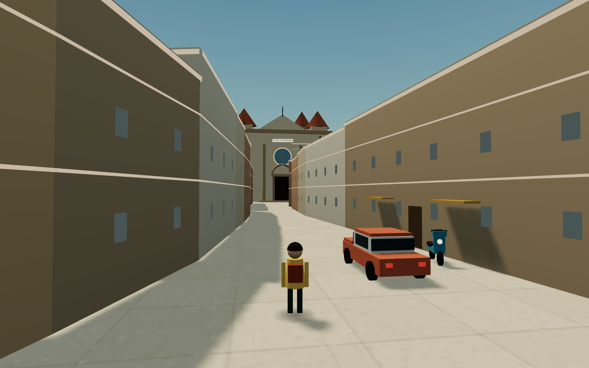

# Fidenza da Giocare



Open world gratuito nel browser ambientato a **Fidenza**, Emilia-Romagna. Guidi auto e Vespa, esplori il centro storico, trovi 27 stelle, scopri 11 luoghi e completi cinque missioni. Tutto in HTML, CSS e JavaScript, senza backend.

> Progetto indipendente e non ufficiale, non affiliato al Comune di Fidenza.

## Avvio

Serve un server statico: i moduli ES e i dati JSON non funzionano aprendo `index.html` con `file://`.

```bash
cd fidenza-city
python3 -m http.server 8080
# apri http://localhost:8080
```

In alternativa:

```bash
npx serve fidenza-city
```

## Comandi

| Azione | Desktop | Mobile |
| --- | --- | --- |
| Muoversi | WASD / frecce | levetta |
| Correre | Shift | pulsante Corri |
| Guardare | mouse (pointer lock) | trascina sul canvas |
| Interagire | E | pulsante ▶ |
| Entrare/uscire dal veicolo | E vicino al veicolo | pulsante ▶ / Auto |
| Freno | Spazio | pulsante Freno |
| Clacson | H | pulsante 📯 |
| Missioni | F | tabellone con ▶ |
| Mappa | N o click sulla minimappa | click sulla minimappa |
| Audio | M | pulsante audio |
| Pausa | Esc / P | Esc |

## Contenuti

- **Mondo**: centro storico di Fidenza, Via Emilia, Piazza Duomo, Duomo di San Donnino, Porta e Ponte San Donnino, Teatro Magnani, Palazzo Comunale, Santuario della Gran Madre, San Pietro, Museo Musini, stazione FS, torrente Stirone.
- **Guida**: auto, Vespa, taxi e ambulanza parcheggiati in città.
- **Missioni**: emergenza al parco, inseguimento in Via Emilia, pizza in Vespa, taxi dalla stazione, cartoline di Fidenza.
- **Collezionabili**: 27 stelle e 11 luoghi con schede informative.
- **Mappa**: minimappa e mappa completa con pan/zoom, stelle, luoghi e obiettivi.
- **Atmosfera**: ciclo giorno/notte, meteo reale (Open-Meteo, con fallback), traffico, pedoni, luci notturne, audio sintetizzato.
- **PWA**: installabile e giocabile offline dopo il primo caricamento.

## Dati e rigenerazione

I dati sono già inclusi in `data/`. Per rigenerarli:

```bash
node tools/build-city.mjs --refresh
node tools/build-terrain.mjs --refresh
```

- `build-city.mjs` scarica OpenStreetMap tramite Overpass e produce `data/city.json`.
- `build-terrain.mjs` scarica i Terrain Tiles (Mapzen / EU-DEM Copernicus) e produce `data/terrain.json`.
- La cache grezza finisce in `.cache/` (ignorata da git).

I dati derivati da OpenStreetMap restano soggetti a **ODbL**. Vedi `data/ATTRIBUTION.md`.

## Struttura

```text
fidenza-city/
  index.html
  manifest.webmanifest
  sw.js
  css/style.css
  js/
    main.js          avvio, loop, interazioni
    config.js        costanti di gioco
    utils.js         matematica, collisioni, heightmap
    save.js          localStorage
    input.js         tastiera, mouse, touch
    audio.js         audio sintetizzato WebAudio
    hud.js           interfaccia DOM
    models.js        auto, Vespa, persone, alberi
    world.js         terreno, strade, edifici, props, traffico
    landmarks.js     modelli dei luoghi simbolo
    player.js        controller terza persona e camera
    vehicles.js      guida arcade
    missions.js      missioni
    map.js           minimappa e mappa completa
  data/
    city.json
    terrain.json
    landmarks.json
    ATTRIBUTION.md
  assets/
    fonts/
    icons/
  tools/
    build-city.mjs
    build-terrain.mjs
  vendor/
    three.module.js
    BufferGeometryUtils.js
```

## Note tecniche

- Three.js è self-hosted; l'import map in `index.html` punta a `vendor/`.
- Le geometrie statiche sono unite per materiale; alberi, lampioni e panchine usano instancing.
- Le collisioni sono 2D (cerchio vs poligono) con spatial hash.
- La mappa 2D è disegnata dai dati della città su un canvas offscreen, senza tile server a runtime.
- Il service worker mette in cache la shell, i dati, i font e Three.js.

> Se modifichi file statici, incrementa la costante `CACHE` in `sw.js` per evitare che il browser serva la versione precedente.

## Licenze

- Codice del gioco: originale, distribuito con la licenza del repository.
- Dati OpenStreetMap: ODbL.
- Terrain Tiles: attribuzione Mapzen / EU-DEM Copernicus.
- Three.js: MIT.
- Font Anton e Oswald: SIL Open Font License 1.1.

Vedi `data/ATTRIBUTION.md` per i dettagli.
