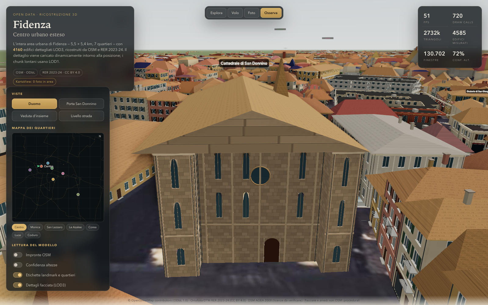

# Fidenza — ricostruzione 3D provenance-first

Ricostruzione 3D dell'**area urbana di Fidenza (PR)**: oltre 4.000 edifici
ricostruiti da impronte OSM, altezze DSM−DTM, tetti e colori campionati
sull'ortofoto RER 2023‑24, con facciate procedurali dichiarate come tali.
L'area copre circa **5,5 × 5,4 km** (10.038–10.108 E, 44.835–44.884 N) e usa un
**LOD3 dinamico a chunk**: ogni edificio del pilot ha descrittori LOD3 completi,
ma il viewer costruisce solo i chunk vicini e mantiene LOD1 batchato per quelli
lontani.



> **Onestà del dato.** Fidenza non ha copertura street-level utilizzabile
> dentro la bbox nel servizio pubblico KartaView. Le facciate sono quindi **ricostruite
> proceduralmente** a partire da morfologia, altezza, archetipo e orthophoto;
> non sono spacciate per ricostruzioni fotografiche. Il report di validazione
> elenca cosa è accurato, approssimato o da rivedere.

---

## Avvio rapido

```bash
# 1. Pipeline Python
python3.11 -m venv .venv
source .venv/bin/activate
pip install -e ".[dev]"

# 2. Viewer web
npm install
npm --prefix web install

# 3. Rigenera dati e modello (richiede rete: Overpass, RER, Wikimedia)
python -m fidenza_recon.cli all

# 4. Sincronizza il payload nel viewer e avvia
npm run data:sync
npm run dev
```

Apri `http://127.0.0.1:5173`.

Per giocare da telefono o tablet nella stessa rete Wi‑Fi:

```bash
npm run dev:lan
```

Apri sul telefono `http://<IP-del-PC>:5173` (l'IP locale del computer che esegue
Vite). Su Windows il firewall può chiedere di consentire Node.js sulla rete
privata. In alternativa, dopo `npm run build`, serve la versione di produzione
con `npm run preview:lan`.

Comandi utili:

```bash
python -m fidenza_recon.cli fetch       # OSM + RER + KartaView + Commons
python -m fidenza_recon.cli analyze     # impronte, altezze, tetti, archetipi
python -m fidenza_recon.cli generate    # descrittori LOD3, chunk, world, database
python -m fidenza_recon.cli report      # report in docs/
python -m fidenza_recon.cli audit       # audit fonti RER 2023-24/DBTR/street-level
python -m fidenza_recon.cli coverage    # audit copertura OSM vs edificato DSM 2008
python -m fidenza_recon.cli export      # export JSON del database in db/exports/
pytest                                  # test Python
npm --prefix web test                   # test TypeScript
ruff check pipeline                     # lint Python
npm run typecheck                       # typecheck TypeScript
npm run screenshots                     # screenshot + GLB + metriche
```

I dati grezzi e i raster sono in `data/raw` (gitignored). Il payload del viewer
è chunked: `data/processed/city/manifest.json`, `world.json`, `massing.json` e
`detail/chunk_<x>_<z>.json`, copiati in `web/public/data/`. Il file
`data/processed/city.json` resta solo come fallback monolitico. Vedi
[`docs/CHUNKED_PAYLOAD.md`](docs/CHUNKED_PAYLOAD.md).

Il database `db/city.db` può essere esportato in JSON, YAML, JSONL o CSV:

```bash
python -m fidenza_recon.cli export --format json
```

L'output predefinito è `db/exports/fidenza-city-db.json` (gitignored), con dati
annidati, schema, conteggi e hash del database di origine.

---

## Scope

| Area | Edifici | Dettaglio |
|---|---:|---|
| **Pilot urbano** — intera bbox 10.038–10.108 E / 44.835–44.884 N, ~5,6×5,4 km | 4.160 | LOD3 completo: facciate con aperture, cornici, balconi, persiane, negozi, portali; tetti con falde, comignoli, paracarro |
| **Buffer di contesto** — ~250 m attorno alla bbox urbana | 425 | Solo LOD1 batchato; nessun descrittore di facciata |

Il pilot copre l’intera area urbana (Centro, Monica, San Lazzaro, Le Azalee,
Corea, Luce e Coduro), non più il solo centro storico. Tutti i 4.160 edifici
pilot hanno descrittori LOD3 completi, ma il viewer li carica a chunk da 120 m:
il dettaglio viene costruito solo intorno alla posizione e i chunk lontani
restano in LOD1.

---

## Fonti e licenze

| Fonte | Uso | Licenza |
|---|---|---|
| [OpenStreetMap / Overpass](https://www.openstreetmap.org/) | Impronte, strade, arredo, civici | **ODbL 1.0** — © OpenStreetMap contributors |
| [RER 2023‑24 ortofoto RGB/NIR](https://geoportale.regione.emilia-romagna.it/approfondimenti/rer23_24) | Colori tetti, NDVI, texture di base | **CC BY 4.0** |
| [DTM RER 2023‑24](https://servizigis.regione.emilia-romagna.it/arcgis/rest/services/public/DtmRER2023_24/ImageServer) | Quota terreno, nDSM | **CC BY 4.0** |
| [DSM AGEA 2008](https://servizigis.regione.emilia-romagna.it/arcgis/rest/services/public/DsmAgea2008/ImageServer) | Superficie edifici per le altezze | Servizio pubblico RER; **licenza da verificare prima della ridistribuzione** |
| [DBTR — Unità volumetrica](https://geoportale.regione.emilia-romagna.it/catalogo/dati-cartografici/cartografia-di-base/database-topografico-regionale) | Fallback qualitativo per edifici senza campioni DSM | **CC BY 4.0** |
| [KartaView](https://kartaview.org/) | Copertura street-level | 5 foto appena fuori dalla bbox; **0 usate** |
| [Wikimedia Commons](https://commons.wikimedia.org/) | Foto di riferimento per la validazione | Licenza per-file (CC BY, CC BY‑SA, pubblico dominio) |

**Google Street View / Photorealistic 3D Tiles non sono usati.** Nessun asset
derivato da Google è presente nel progetto.

L'inventario completo, con URL, data di pubblicazione, risoluzione e checksum,
è generato in [`docs/DATA_INVENTORY.md`](docs/DATA_INVENTORY.md) e
[`docs/LICENSES.md`](docs/LICENSES.md).

---

## Pipeline

```
OSM Overpass ─┐
RER ortofoto ─┼─> data/raw ─> buildings_base ─> heights (nDSM) ─> roofs ─> classify
RER DTM/DSM ──┘                                      │
Wikimedia ────> reference imagery                    v
                                              descriptors.json
                                                     │
                                                     v
                                   manifest/world/massing + detail chunks
                                                     │
                                                     v
                                     Three.js viewer (procedural LOD3)
```

Moduli principali:

- `pipeline/fidenza_recon/fetch/overpass.py` — query, parsing way/relation,
  strade, arredo, civici.
- `fetch/rer.py` — export GeoTIFF georeferenziati da ArcGIS ImageServer,
  ortophoto/NIR/DTM/DSM, texture di base con correzione colore **solo display**.
- `fetch/kartaview.py` — griglia di copertura, riporta l'assenza di foto.
- `fetch/commons.py` — reference photography con rate limiting, licenze e autori.
- `analyze/buildings.py` — proiezione locale, impronte, lati, contesto stradale,
  distinzione pilota/contesto.
- `analyze/heights.py` — `nDSM = DSM 2008 − DTM 2023‑24`, percentile robusto,
  maschera vegetazione NDVI, confidenza per edificio.
- `analyze/roofs.py` — forma del tetto da nDSM, colore misurato da ortofoto,
  normalizzazione del colore di visualizzazione (il colore misurato resta nel DB).
- `analyze/classify.py` — archetipi con regole ed evidenze, tier A/B/C.
- `generate/descriptors.py` — grammatica di facciata deterministica (seed =
  OSM ID): campate, finestre, porte, negozi, balconi, cornici, lesene.
- `generate/city.py` — terreno, strade, arredo, `manifest.json`, `world.json`,
  `massing.json` e chunk LOD3 `detail/chunk_<x>_<z>.json`.
- `export/db_export.py` — popola `db/city.db` (edifici, facciate, imagery,
  validazione).
- `export/db_dump.py` — esporta `db/city.db` in JSON/YAML/JSONL/CSV con schema,
  conteggi e metadati di provenienza.
- `validate/report.py` — report di inventario, licenze, copertura, classificazione,
  confidenza e validazione.

### Coordinate

- CRS metrico: **EPSG:7791** (RDN2008 / UTM 32N).
- Origine locale: Duomo di San Donnino (`10.0578098, 44.866476`).
- Runtime: `x = est`, `z = sud`, `y = su`, metri. Nessuna coordinata globale
  inviata alla GPU.

---

## Viewer e generazione procedurale

- **Three.js + Vite + TypeScript strict**.
- **Materiali PBR procedurali**: albedo, normal, roughness e AO generati in
  locale per intonaco, mattone, pietra, calcestruzzo, coppi, metallo, asfalto
  e pavimentazione; normal scale e riflessioni distinte per materiale.
- **Postprocessing su preset Alta**: SSAO, SMAA e output pass; preset Media/Bassa
  usano il renderer diretto per mantenere la fluidità.
- **LOD dinamico gerarchico**: batch LOD1 per chunk padre da 480 m; avvicinandosi
  il padre è sostituito da chunk figli da 120 m, e i figli passano a LOD3 quando
  il file di dettaglio è pronto. Il passaggio LOD1→LOD3 usa un breve crossfade.
  Cache limitata e rilascio dei chunk lontani.
- Dettagli di facciata: `InstancedMesh` globali (telai, vetri, persiane,
  balconi, cornici, lesene, archi) → poche draw call per migliaia di elementi.
- Muri con **aperture reali** (ExtrudeGeometry con holes), telai, vetri,
  davanzali, persiane, balconi con ringhiere in ferro o pietra, cornici,
  lesene, portali, rosoni, croci di colmo.
- Tetti: piani, a falde, a padiglione, mansardati; comignoli, paracarro,
  camini, pluviali.
- Strade: marciapiedi, cordoli, attraversamenti, segnaletica; la superficie
  stradale usa l'ortofoto reale per evitare texture inventate.
- **Ortofoto multi-risoluzione**: 1 m sull'intera bbox, **0,5 m sul pilot** e
  **0,2 m sul centro storico** per colore tetti e NDVI.
- **Ground streaming**: 529 tile da 250 m (513 a 0,5 m, 16 a 0,2 m) caricate
  in un intorno del giocatore, con LRU e fallback alla texture globale.
- **Ora del giorno**: slider 0–24 h con sole, cielo, nebbia, esposizione e
  finestre emissive coerenti; preset Alta/Media/Bassa.
- Debug: impronte OSM, heatmap confidenza altezze, etichette landmark e
  quartieri, mappa 2D dei quartieri con posizione del giocatore e teletrasporto,
  ispettore provenienza al click.
- Export **GLB** dal viewer (`GLTFExporter`), in LOD1 completo dell’area estesa.
- **Streaming LOD3**: `web/src/viewer/lod-manager.ts` scarica i chunk di dettaglio
  vicini, mantiene visibile il LOD1 finché non sono pronti e rilascia i chunk
  lontani per contenere la memoria. Il toggle “Dettagli facciata (LOD3)” e il
  preset Alta/Media/Bassa controllano il dettaglio dinamico.

### Controlli

Il viewer ha quattro modalità, selezionabili dalla barra in alto (o dai pulsanti
a schermo su telefono e tablet):

- **Esplora** (predefinita). Personaggio in terza persona davanti al Duomo.
  - `Frecce` o `WASD`: movimento relativo alla camera.
  - `Shift`: corsa. `Spazio`: salto.
  - Trascina con il mouse per orbitare la camera, rotella per lo zoom.
  - La camera segue da dietro e si accorcia quando un edificio si frappone.
- **Volo**. `F` o il pulsante "Volo" attiva il volo del personaggio.
  - `Spazio`: salita. `C`: discesa. `F`: atterra.
  - Si può volare sopra i tetti e atterrarci; disattivando il volo si ricade.
- **Foto**. `P` oppure il pulsante "Foto".
  - Camera libera con `WASD`/frecce e trascinamento; `E`/`C` per salire e scendere.
  - Griglia dei terzi, slider FOV, toggle personaggio, scatto in PNG.
  - `Spazio` o `Invio` scatta, `Esc` esce.
- **Osserva**. Mantiene l'orbit camera e l'ispettore dell'edificio (`O` o il pulsante "Osserva").
  - Tasti `1`–`4`: Duomo, Porta San Donnino, veduta d'insieme, livello strada.
  - Click su un edificio per ispezionare fonte, confidenza, archetipo e dettagli.

Da telefono o tablet compare un joystick virtuale a sinistra, il trascinamento
sulla scena per guardare e pulsanti a schermo per salto/salita, discesa, volo e
foto. La corsa si attiva inclinando il joystick al massimo. Il pulsante menu
apre i controlli avanzati, quello a schermo intero attiva il fullscreen quando
supportato.

---

## Validazione e qualità

Report generati:

- [`docs/VALIDATION_REPORT.md`](docs/VALIDATION_REPORT.md)
- [`docs/CONFIDENCE_REPORT.md`](docs/CONFIDENCE_REPORT.md)
- [`docs/ARCHITECTURE_CLASSIFICATION.md`](docs/ARCHITECTURE_CLASSIFICATION.md)
- [`docs/DISTRICTS.md`](docs/DISTRICTS.md)
- [`docs/CHUNKED_PAYLOAD.md`](docs/CHUNKED_PAYLOAD.md)
- [`docs/DATA_AUDIT_2023_24.md`](docs/DATA_AUDIT_2023_24.md)
- [`docs/COVERAGE_AUDIT.md`](docs/COVERAGE_AUDIT.md)
- [`docs/OSM2WORLD_SPIKE.md`](docs/OSM2WORLD_SPIKE.md)
- [`docs/IMAGERY_COVERAGE.md`](docs/IMAGERY_COVERAGE.md)
- [`docs/DATA_INVENTORY.md`](docs/DATA_INVENTORY.md)
- [`docs/LICENSES.md`](docs/LICENSES.md)

Numeri chiave dell'ultima esecuzione:

- **4.585 edifici reali**: 4.160 pilot LOD3 + 425 contesto
- **130.754 finestre** e **27.622 balconi** procedurali
- 4.474 / 4.585 altezze misurate da DSM−DTM; 91 fallback DBTR UVL dichiarati
  e 20 stime tipologiche residue
- confidenza mediana delle altezze: **72%**
- foto di riferimento Wikimedia Commons (licenza per-file); **0 foto KartaView
  nella bbox** (5 appena fuori, non usate)
- **25.372 facciate** registrate nel DB con layout e provenienza
- **Ortofoto tetti**: 1.370 edifici a 0,2 m, 2.790 a 0,5 m, 425 a 1 m
- 2.626 righe di validazione, di cui 2.622 edifici flaggati per review
- bbox reale ~5,6×5,4 km; payload iniziale ~16,5 MB (manifest + world + massing,
  ~2,4 MB gzip) e 864 chunk di dettaglio per ~56,5 MB totali; ortofoto 4096 px

### Tier di confidenza

- **A** — landmark con riferimento fotografico licenziato e geometria misurata.
- **B** — altezza/tetto misurati, facciata procedurale inferita.
- **C** — solo impronta o altezza da fallback; confidenza bassa.

### Limiti dichiarati

1. **Nessuna street imagery utilizzabile**: KartaView non ha foto dentro la
   bbox di Fidenza (5 scatti appena fuori, non usati). Le facciate
   generiche non sono verificabili fotograficamente.
2. **DSM 2008 vs DTM 2023‑24**: l'altezza è cross-epoch; l'incertezza è
   registrata per edificio. Il DSM AGEA 2008 ha licenza da verificare.
3. **Colore dei tetti**: misurato sull'ortofoto, ma normalizzato per la
   visualizzazione; il valore misurato è conservato in `roof_colour_measured`.
4. **LOD dinamico e contesto residuo**: 4.160 edifici sono pilot LOD3; 425
   edifici nel buffer di contesto restano LOD1. I chunk lontani sono resi con
   batch LOD1; il LOD3 viene costruito proceduralmente intorno alla camera e
   non è una ricostruzione fotografica delle facciate.
5. **Texture di base**: l'ortofoto è color-graded solo per il display; i
   GeoTIFF usati per le misure sono intatti.
6. **Tetti mansardati**: il tipo è conservato nel record, ma la geometria è
   approssimata come padiglione a due falde.
7. **Ricognizione dataset**: non è emerso un CityGML/CityJSON comunale pubblico
   per Fidenza. Il DSM RER 2023‑24 esiste come prodotto preconfezionato, ma non
   era esposto come servizio aperto in questa build: è stato usato il DSM AGEA
   2008 pubblico, con l'incertezza cross-epoch dichiarata.
8. **Validazione manuale**: i landmark sono confrontati con Commons; non c'è
   un benchmark automatico di similarità fotografica.
9. **Prestazioni**: il test headless Chrome/SwiftShader a 1600×1000 riporta
   49–60 fps con 348–817 draw call e 0,6–2,8 M triangoli a seconda della vista;
   il GLB LOD1 completo è di ~23,7 MB. Su GPU reale le prestazioni sono più alte,
   ma vanno riverificate sull'hardware target. Il raggio LOD3 è adattivo:
   200 m col preset Alta (desktop), 140 m col preset Media (mobile), 0 m col
   preset Bassa (solo LOD1), con cache di 24/12 chunk dettagliati.

---

## Struttura del progetto

```
fidenza-recon/
├── config/                 # città, archetipi, materiali
├── pipeline/fidenza_recon/ # fetch, analyze, generate, export, validate
├── web/                    # viewer Three.js + Vite
│   └── src/city/           # generatori facciate, tetti, edifici, strade, props
│       src/viewer/         # scena, camera, LOD manager, modalità foto
├── data/raw/               # cache OSM/RER/Commons (gitignored)
├── data/processed/         # descriptors, raster nDSM/NDVI, city/ (manifest, world, massing, detail chunks), GLB
├── db/city.db              # provenienza, edifici, facciate, imagery, validazione
├── docs/                   # report + screenshots
└── scripts/                # sync dati, screenshot/GLB
```

---

## Deliverable (specifica §13)

| # | Deliverable | Dove |
|---|---|---|
| 1 | Modello 3D aggiornato | `web/` + `data/processed/export/fidenza-piazza-duomo.glb` |
| 2 | Database metadati edifici | `db/city.db` (4.585 edifici, 25.372 facciate, imagery di riferimento) |
| 3 | Inventario fonti e licenze | `docs/DATA_INVENTORY.md`, `docs/LICENSES.md` |
| 4 | Report copertura imagery | `docs/IMAGERY_COVERAGE.md` |
| 5 | Report classificazione architettonica | `docs/ARCHITECTURE_CLASSIFICATION.md` |
| 6 | Generatore procedurale edifici | `pipeline/.../generate/descriptors.py`, `web/src/city/building.ts` |
| 7 | Sistema di generazione facciate | `web/src/city/facade.ts`, `config/archetypes.yaml` |
| 8 | Sistema LOD | `web/src/city/building.ts` (`THREE.LOD`), `web/src/viewer/lod-manager.ts` (chunk dinamici) |
| 9 | Screenshot di confronto | `docs/screenshots/` |
| 10 | Report qualità e confidenza | `docs/CONFIDENCE_REPORT.md`, `docs/VALIDATION_REPORT.md` |

---

## Riproducibilità

- Ogni dataset ha URL, data di accesso, risoluzione, bbox, licenza e checksum
  in `db/city.db` e `docs/DATA_INVENTORY.md`.
- I descrittori di facciata sono deterministici: stesso OSM ID + stessa
  configurazione ⇒ stesso layout.
- La pipeline è idempotente con `--force`; senza `--force` usa la cache locale.
- Il report di validazione non dichiara mai un'approssimazione come ricostruzione
  esatta: i tier e i flag procedurali sono espliciti in ogni record.
