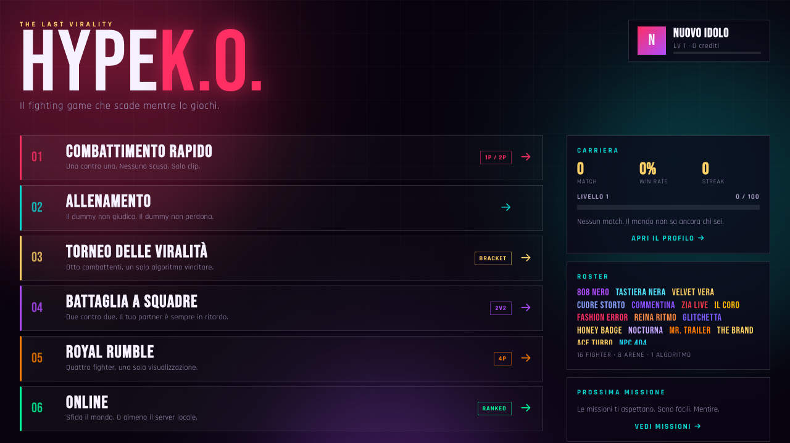
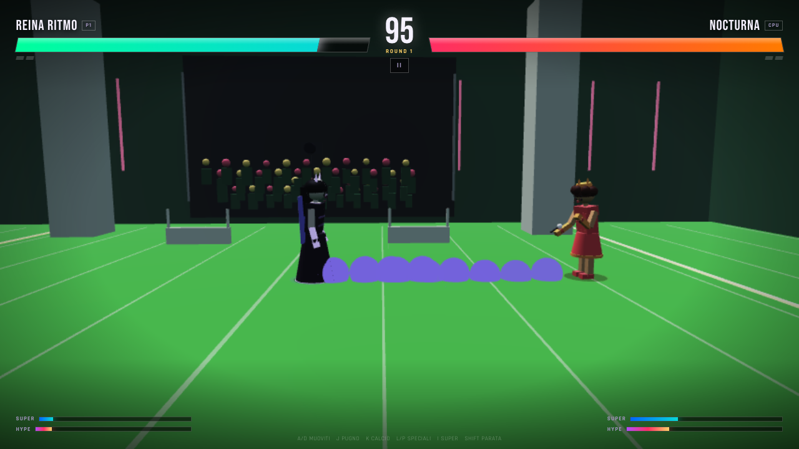

# HYPE K.O. — THE LAST VIRALITY

A complete 3D browser fighting game about internet fame, bad decisions and the last festival before the algorithm takes over. Built with React, TypeScript, Babylon.js and a pure deterministic combat simulation.





## What's inside

- **16 original fighters**, each with unique stats, specials, supers, finishers, AI profiles, quotes and rivalries.
- **8 arenas** with procedural sets, crowds, neon, props, dynamic screens and per-stage music motifs.
- **Six offline modes**: Quick Match, Training, Tournament, 2v2 Team Battle, 4-fighter Royal Rumble and local 2-player versus.
- **Real online multiplayer** over WebSocket with a server-authoritative 60 Hz simulation, room codes, ready-up, rematch and a shared leaderboard.
- **Full combat system**: light/heavy normals, specials, super meter, Hype Breaker, Hype Finish, blocking, parries, counters, grabs, tag switches, projectiles, zones, explosions and hitstop.
- **Procedural visuals**: every character, outfit, hair style, arena and VFX is generated in code. No external models, textures or audio files.
- **Procedural audio**: Web Audio synthesized music and SFX plus a SpeechSynthesis announcer.
- **PWA**: installable, offline-capable shell, generated icons and service worker.
- **Persistence**: profile, settings, missions, tournament bracket and local leaderboard in `localStorage`.
- **Tests**: deterministic combat and AI tests with Vitest; browser smoke tests with Playwright.

## Quick start

Requirements: Node.js 20+ (developed on Node 25), npm and a WebGL2/WebGPU-capable browser.

```bash
npm install
npm run dev
```

- Client: http://localhost:5173
- Online server + API: http://localhost:8787
- The Vite client proxies `/api` to the game server. WebSocket clients connect to port `8787` automatically in development.

### Production

```bash
npm run build
npm start
```

`npm start` serves the built `dist/` folder, the WebSocket server and `/api/leaderboard` from a single Node process on http://localhost:8787. Change the port with `PORT=9000 npm start`.

### All scripts

| Script | What it does |
| --- | --- |
| `npm run dev` | Vite client + WebSocket server with hot reload |
| `npm run dev:client` | Vite only |
| `npm run dev:server` | Game server only (`tsx watch`) |
| `npm run build` | Typecheck + production build into `dist/` |
| `npm start` | Serve the production build + online server |
| `npm run preview` | Vite preview of `dist/` |
| `npm run typecheck` | `tsc --noEmit` |
| `npm run lint` | ESLint |
| `npm test` | Vitest combat/AI tests |
| `npm run test:e2e` | Playwright browser smoke tests |
| `npm run icons` | Regenerate PWA PNG icons |

## Controls

Default bindings. Every action can be remapped in **Impostazioni → Comandi**, and gamepads are detected automatically.

| Action | Player 1 | Player 2 |
| --- | --- | --- |
| Move | `A` / `D` | `←` / `→` |
| Jump | `W` | `↑` |
| Crouch | `S` | `↓` |
| Light punch | `J` | `Numpad 1` |
| Light kick | `K` | `Numpad 2` |
| Special 1 | `L` | `Numpad 3` |
| Special 2 | `P` | `Numpad 5` |
| Super | `I` | `Numpad 4` |
| Hype Breaker | `Y` | `Numpad 6` |
| Hype Finish | `F` | `Numpad 7` |
| Block | `Shift` | `Numpad 8` |
| Grab | `U` | `Numpad 9` |
| Tag switch | `O` | `Numpad 0` |

Notes:

- Forward + punch/kick performs the heavy version of that normal.
- Block just before an attack lands to parry; parries open counter windows.
- Hype Breaker costs 50% Hype and beats block. Hype Finish unlocks at 100% Hype when the opponent is below 25% health.
- Training mode adds dummy behavior (stand/block/counter/CPU), infinite health/meter and reset.
- Touch controls appear automatically on coarse-pointer devices; P2 local versus requires a keyboard/gamepad.

## Modes

- **Quick Match** — 1P vs CPU or local 2P versus.
- **Training** — free practice with a configurable dummy and infinite resources.
- **Torneo delle Virilità** — 8-fighter single-elimination bracket; AI matches are simulated deterministically.
- **Battaglia a Squadre** — 2v2 with active-fighter tag switching.
- **Royal Rumble** — 4 fighters, last team standing.
- **Online** — create/join a 4-character room code, ready up, play a server-authoritative match, rematch.

## Roster

808 NERO · TASTIERA NERA · VELVET VERA · CUORE STORTO · COMMENTINA · ZIA LIVE · IL CORO · FASHION ERROR · REINA RITMO · GLITCHETTA · HONEY BADGE · NOCTURNA · MR TRAILER · THE BRAND · ACE TURBO · NPC 404

## Arenas

THE LAST FESTIVAL · METRO 0317 · CLUB VERTICALE · STADIO DEI COMMENTI · STUDIO 9B · MALL OF TOMORROW · NEON RODEO · PIT LANE

## Online architecture

```text
Browser A ── WebSocket ──┐
                         ├── Node game server (authoritative MatchSim @ 60 Hz)
Browser B ── WebSocket ──┘        │
                                  ├── room codes / ready / rematch
                                  ├── snapshots every 3 ticks
                                  ├── match summary per player
                                  └── server/leaderboard.json (top 100)
```

- The server owns the simulation. Clients send input state and render authoritative snapshots.
- Each client builds its local render config in server player order, so both clients see the same fighters on the same sides; the HUD marks your side with `TU`.
- If the opponent disconnects, the match ends with an “AVVERSARIO DISCONNESSO” notice and returns to online lobby.
- Online requires the game server port (`8787`) to be reachable. For a remote host, set `VITE_WS_URL` at build time:

```bash
VITE_WS_URL=wss://your-host.example/ws npm run build
```

If the server is behind a reverse proxy, forward both HTTP and WebSocket traffic to port `8787`.

## Project structure

```text
src/
  app/            App state machine and shared screen types
  components/     React screens (menu, select, stage, fight, results, online, ...)
  data/           Fighter, stage, rivalry and mission definitions
  game/
    combat/       Pure deterministic combat simulation (no Babylon imports)
    ai/           Seeded AI controller with four difficulties
    engine/       Babylon backend, character rig, stage rig, VFX, match renderer
    animations/   Procedural pose animator
    camera/       Dynamic match camera
    audio/        Web Audio music/SFX and announcer
    input/        Keyboard, gamepad, touch and remapping
    modes/        Tournament bracket and AI simulation
  network/        WebSocket online client
  styles/         Global UI and HUD CSS
  utils/          Local storage profile/settings/leaderboard
server/           Node HTTP + WebSocket game server
scripts/          PWA icon generator
tests/            Vitest unit tests + Playwright e2e tests
```

The combat simulation is fully independent from React and Babylon. That makes AI tests, tournament simulation and the authoritative online server reuse the exact same rules as the local game.

## Testing

```bash
npm test
npm run lint
npm run typecheck
npm run test:e2e
```

- Vitest covers combat determinism, moves, rounds, training behavior and AI decisions.
- Playwright covers the menu/settings flow, a full quick match reaching the arena, and two clients creating/joining/starting an online match.

## Save data and privacy

The game collects no analytics and sends no data to third parties.

- `hypeko.profile.v1`, `hypeko.settings.v1`, `hypeko.leaderboard.v1` — browser `localStorage`.
- `server/leaderboard.json` — online names/scores written by the local game server (ignored by git).
- No accounts, cookies, ads or tracking. Clearing site data resets the local profile.

## Asset licenses

All game assets are procedural or open-source dependencies. See [docs/ASSETS-LICENSES.md](docs/ASSETS-LICENSES.md).

## Known limitations

- WebGPU is used when available; otherwise the game falls back to WebGL2 automatically. The active backend is chosen per match.
- The online server keeps rooms in memory and is intended for a single process. Restarting it drops active rooms.
- Online is 1v1 only; local offline modes support teams and rumble.
- The PWA shell caches the large Babylon bundle. First install may take a moment on slow connections.
- Touch controls are for Player 1 only. Local 2P needs keyboard or gamepad.
- The game is in Italian (UI, bios, mission text, announcer lines). Controls and code are language-neutral.

## Troubleshooting

- **Black canvas / no WebGL**: enable hardware acceleration in the browser. The game needs WebGL2; headless/VM environments may be very slow.
- **Online connection error**: make sure the server is running (`npm run dev` or `npm start`) and port `8787` is not blocked. In dev, open the game via `http://localhost:5173`, not a `file://` URL.
- **No sound**: browsers require a click/keypress before audio starts. The first interaction unlocks Web Audio.
- **Old build after update**: clear the PWA/service worker cache or use DevTools → Application → Unregister service worker.
- **Icons missing**: run `npm run icons` to regenerate `public/icons/*.png`.

## Credits

Design, code, procedural art, music and questionable copy: the HYPE K.O. team inside this repository.

Fonts: **Bebas Neue** and **Rajdhani** via Fontsource, SIL Open Font License.
Engine: **Babylon.js**, Apache License 2.0.
UI: **React**, MIT License.

All fighters, brands, arenas and quotes are fictional. Any resemblance to real people or internet phenomena is a marketing strategy.
