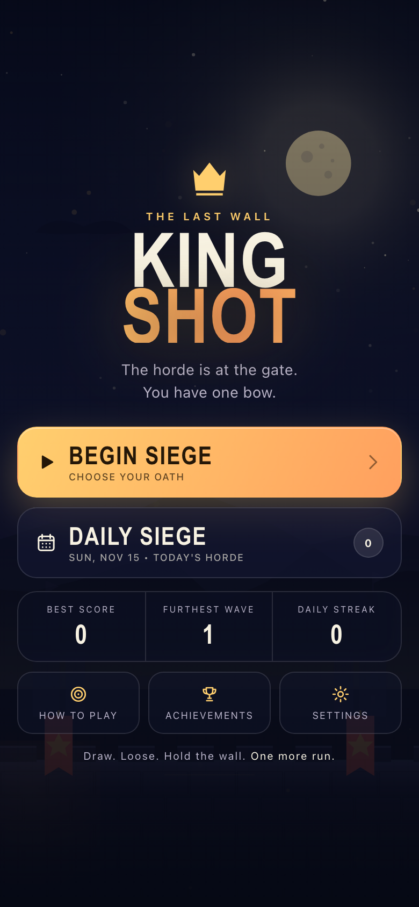
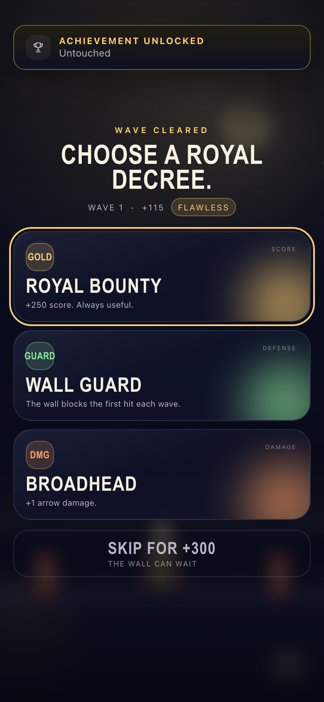

# KING SHOT — The Last Wall

A one-more-run archery roguelite for the browser. The horde is at the gate. You
have one bow.

Drag, loose, and hold the wall. Clear a wave, draft a royal decree, then do it
again with a bigger combo and a worse temper. Warlords arrive every five waves.
The daily siege gives every player the same horde.

**Play:** <https://lucagandolfi77.github.io/random2/king-shot-pwa/>



## What is it?

A fast, mobile-first defense game built around a slingshot bow:

- Drag anywhere to set angle and power, release to fire. A dotted arc previews
  gravity and wind.
- Hit an enemy dead centre for a **bullseye**: double damage and a louder crowd.
- Chain kills while the combo window is open to raise the multiplier. Let it
  lapse and the crowd goes quiet.
- Every fifth wave a **warlord** enters: more health, boulders to shoot out of
  the air, and a bad attitude.
- Clear a wave and choose one of three **royal decrees** from a pool of
  thirteen upgrades.

## Three Oaths

| Oath | Hearts | Horde | Score |
| --- | --- | --- | --- |
| Squire | 7 | Slower | x0.8 |
| Knight | 5 | Standard | x1 |
| Warlord | 3 | Faster | x1.5 |

The daily always calls for a Knight.

## The siege

- **Wind** pushes arrows mid-flight. Read the HUD, lead the shot, or draft
  Windreader and stop caring.
- **Royal Volley** is an active ability. Buy it in a draft, then fire with `Q`
  or the HUD button. It seeks the closest targets.
- **Decrees** cover damage, draw speed, multishot, piercing, wall repair, combo
  windows, boss damage, pickups, bullseye size, wall guards and score.
- **Pickups** drop from kills: Triple Nock, Bodkin Oil, Frost Wind and Royal
  Mending.
- **Enemies**: slimes wobble, bats swoop, cinder imps zigzag, stone brutes soak
  damage, and warlords throw the furniture.
- **Themes**: Royal Night, Synthwave, Emerald Dawn, Deep Tide.
- **Eight achievements**, career stats and a local daily streak.

## Daily Siege

One date-seeded siege per day. Enemy order, wind and draft choices are
deterministic from the date; the seed is split from the drop stream so the
horde and decrees stay the same for everyone. Replays are free, only the best
score of the day is kept. Streaks, daily bests and achievements live in
`localStorage`; there is no account and no backend.



## Controls

- **Touch / mouse** — drag to aim, release to loose.
- **Arrow keys** — adjust angle (left/right) and power (up/down).
- **Space** — fire at the current angle.
- **Q** — Royal Volley.
- **P / Escape** — pause.
- **1 / 2 / 3** — choose a decree while drafting.

## Development

No build step, no dependencies, no external assets. Serve the repository with
any static server:

```sh
python3 -m http.server 8099
# open http://localhost:8099/king-shot-pwa/
```

Tests use Node's built-in runner:

```sh
node --test king-shot-pwa/tests/*.test.mjs
```

The browser smoke test uses the dependency-free CDP helper and Chrome:

```sh
node king-shot-pwa/smoke.mjs http://localhost:8099/king-shot-pwa/
```

It checks the menu, oath start, drag-to-fire, draft, pause, result screen,
daily, settings, service worker and offline reload, and writes the screenshots
in `shots/`.

Icons are rasterised from `icons/icon.svg` with sharp borrowed from
`bucio/node_modules` (the PNGs are committed):

```sh
node king-shot-pwa/scripts/gen-icons.mjs
```

The social card source is `scripts/og.html`; `og-cover.png` is a 1200x630
headless Chrome capture of it. `scripts/og.html` is development-only and is not
precached.

## Structure

```
king-shot-pwa/
├── index.html              # shell, HUD, menus, meta/OG/JSON-LD
├── styles.css              # themes, safe-area layout, motion, components
├── package.json            # "type": "module" for the browser modules/tests
├── src/
│   ├── config.js           # palettes, oaths, physics, economy constants
│   ├── rng.js              # seeded RNG and daily date keys
│   ├── content.js          # enemies, upgrades, achievements, wave tables
│   ├── sim.js              # pure headless simulation
│   ├── storage.js          # profile, migration, daily streak, achievements
│   ├── audio.js            # procedural WebAudio SFX and war-drum music
│   ├── render.js           # cached scene, entities, particles, aiming arc
│   ├── ui.js               # screens, HUD, draft cards, results, toasts
│   └── main.js             # boot, input, loop, PWA lifecycle
├── tests/                  # node:test suites (sim, storage, content, assets)
├── smoke.mjs               # real-browser CDP smoke test
├── scripts/
│   ├── gen-icons.mjs       # sharp rasteriser for committed PNGs
│   └── og.html             # social-card source
├── icons/                  # SVG source + PNG/any/maskable/apple icons
├── shots/                  # mobile screenshots used by this README
├── og-cover.png            # 1200x630 social card
├── manifest.json           # English PWA manifest with shortcuts
└── service-worker.js       # v6 offline precache (all src modules)
```

## Technical notes

- Canvas 2D rendering at device-pixel-ratio up to 2, CSS-pixel game logic.
- Backdrop is cached offscreen; only entities, aim and effects redraw.
- Swept segment-circle collision, so fast arrows cannot tunnel.
- The simulation is DOM-free: `sim.js` is imported directly by Node tests.
- Separate wave, spawn and drop RNG streams keep daily runs deterministic even
  after different player actions.
- The service worker precaches the module graph, icons and shared arcade
  helper; navigations fall back to the cached shell offline.
- `prefers-reduced-motion` and the in-game switch remove shake and reduce
  particles. Sound, music and haptics follow the shared `random2-settings`
  blob used by the rest of the arcade.
- Scores, best wave, per-oath bests, daily streaks and achievements are stored
  locally under `king-shot-pwa`.

## License

Open source; modify and share it.
