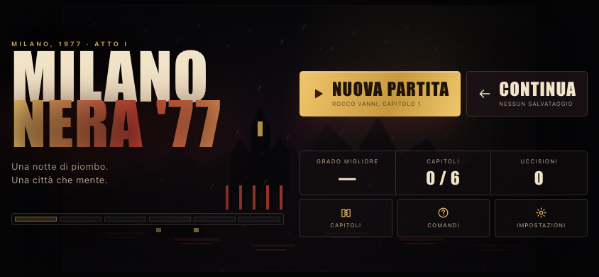
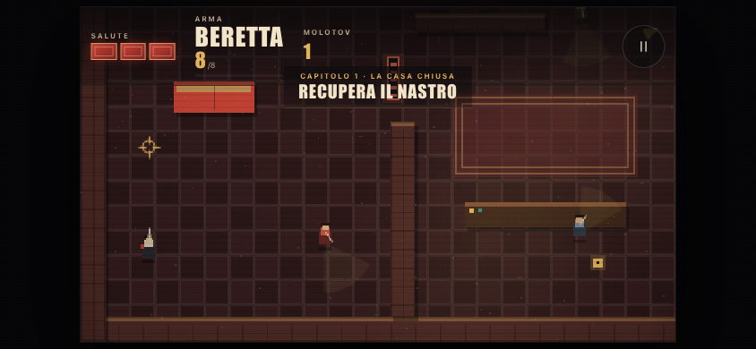
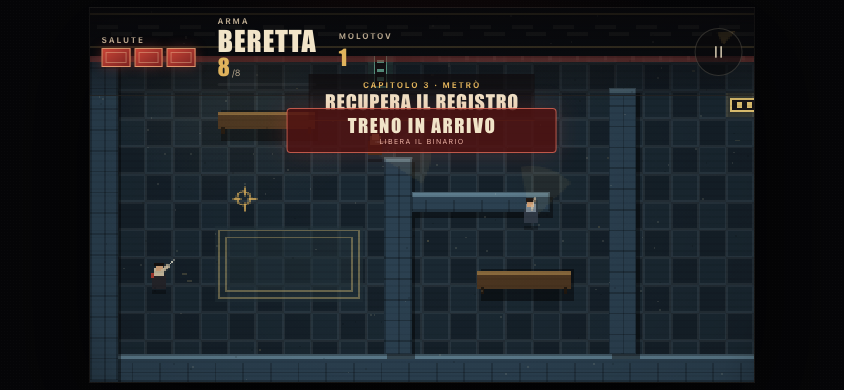
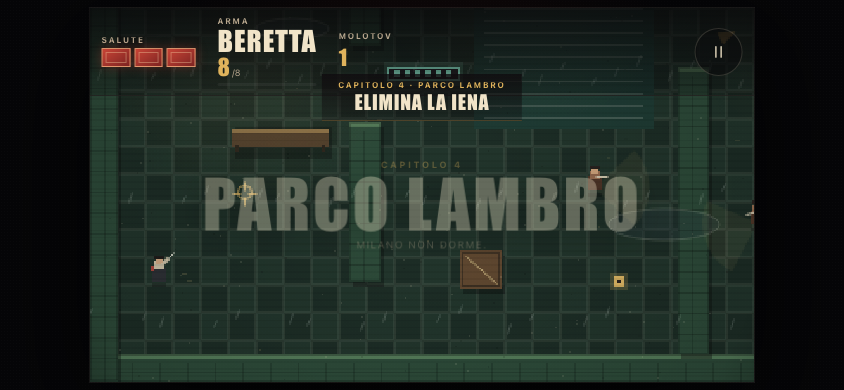
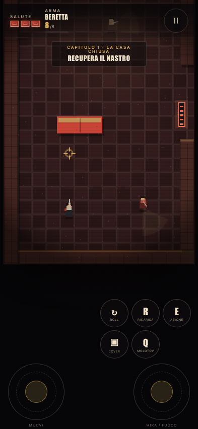

# MILANO NERA '77

Milano, 1977. Un ex detenuto, una pistola e una città che mente.

Un twin-stick shooter noir per il browser, costruito come omaggio originale ai
poliziotteschi italiani e ai giochi d'azione a copertura. Sei capitoli in tre
atti, un boss intermedio, un boss finale, un inseguimento e due nuove zone. Nessun
asset, nome o personaggio di Milanoir è stato riutilizzato: meccaniche e
atmosfera sono reinventate in una storia nuova.

**Gioca:** <https://lucagandolfi77.github.io/random2/milano-nera-pwa/>



## La notte

Rocco Vanni esce dal San Vittore con una sola certezza: qualcuno ha venduto il
suo nome. La pista attraversa Milano in sei capitoli, dal Palazzo alla Darsena,
passando per la metropolitana e il Parco Lambro.

- **La Casa Chiusa** — stealth, visione dei nemici, takedown alle spalle,
  prima pistola, nastro compromettente.
- **Torre Velasca** — sparatorie con cover, cecchini, mitraglieri, guardie e
  Il Ragioniere.
- **Metrò** — Stazione Centrale, piattaforme, treni merci e il registro del
  corriere. Nuovo hazard ferroviario.
- **Parco Lambro** — pioggia, cani da guardia, fucili a pompa e la resa dei conti
  con La Iena.
- **Tangenziale** — inseguimento automobilistico, traffico e pioggia.
- **Darsena** — il boss finale Il Bianco e l'epilogo.



## Come si gioca

- **WASD / frecce** muovi.
- **Mouse** mira; **tasto sinistro** spara.
- **R** ricarica; **Shift** rotola; **Spazio** copertura; **E** takedown,
  salto o uscita; **Q** molotov; **P / Esc** pausa.
- **Gamepad**: stick sinistro movimento, stick destro mira, RT fuoco, A rotola,
  X ricarica, Y azione, LB copertura, RB molotov.
- **Mobile**: stick sinistro per muoverti, stick destro per mirare e sparare
  automaticamente; pulsanti per roll, ricarica, azione, cover e molotov.

La salute è di tre fotogrammi. Dopo qualche secondo senza piombo si rigenera un
fotogramma. I proiettili sono reali e vengono fermati da muri, mobili e
coperture. I cartelli al neon rimbalzano i proiettili della pistola. Un takedown
silenzioso evita l'allarme e vale più di una sparatoria.

## Caratteristiche

- Sei capitoli in tre atti, due boss, un inseguimento e due nuove location.
- Pistola, SMG, revolver a sei colpi, Lupara a canne mozze e molotov.
- Cover, roll con invulnerabilità breve, vault contestuale, takedown stealth.
- AI con visione, linea di vista, allarme, pattugliamento e stati di combattimento.
- Cani veloci, sicari con fucile a pompa, boss con pattern di fuoco e barra dedicata.
- Treno merci con preavviso, corsia investita e HUD di allerta.
- Insegne al neon, pioggia, pozzanghere e due nuove palette (Metrò, Parco).
- Pixel art procedurale a 384x216, cache delle stanze, grana, vignettatura,
  bruciature da pellicola e scossa schermo.
- Musica funk sintetizzata e SFX WebAudio, senza file audio esterni.
- Salvataggi locali: capitoli aperti, gradi migliori, tempi e uccisioni.
- PWA installabile e offline, in italiano, con icone PNG/maskable, OG image e
  screenshot generati dal test browser.
- Single-player; il co-op locale resta un'estensione futura, non ancora inclusa.





## Interfaccia

- Title screen con atto corrente, film strip dei sei capitoli e key art notturna.
- Selezione capitoli divisa in Atto I, II e III, con gradi e blocchi.
- HUD con bussola obiettivo, ricarica visiva, avviso treno e prompt contestuale.
- Intro a pannelli, risultati con timbro del grado, pausa dossier e impostazioni
  con volumi separati per master, musica ed effetti.
- Layout landscape, touch target più grandi, safe area e reduced motion.



## iPhone

- Layout portrait dedicato con vista `216x300` e controlli sotto il campo di gioco.
- Landscape `384x216` con canvas e HUD dentro notch e safe area.
- `dvh`/`svh`, `visualViewport`, `env(safe-area-inset-*)`, rotazione fluida.
- Audio sbloccato al primo tocco; resume dopo background.
- Startup image per i principali iPhone in portrait e landscape.
- Guida “Aggiungi alla scrivania” per Safari e Chrome iOS.
- Gestione touch iOS: no callout, no selezione, pointer capture e multi-touch.
- Checklist device: `IPHONE.md`.

Target: iOS 16.4+.

## Sviluppo

Nessuna build, nessuna dipendenza, nessun asset binario usato come sprite.
Serve solo un server statico:

```sh
python3 -m http.server 8099
# apri http://localhost:8099/milano-nera-pwa/
```

Test della simulazione, dei contenuti, dell'AI, dei salvataggi e del contratto
PWA:

```sh
node --test milano-nera-pwa/tests/*.test.mjs
```

Smoke test nel browser reale, con menu, combattimento, pausa, risultato, boss,
inseguimento, touch, service worker e reload offline:

```sh
node milano-nera-pwa/smoke.mjs http://localhost:8099/milano-nera-pwa/
node milano-nera-pwa/iphone-smoke.mjs http://localhost:8099/milano-nera-pwa/
```

Il primo test copre il gioco desktop/landscape; il secondo usa un Chrome iOS user
agent, touch e DPR 3 per il layout iPhone. Scrivono gli screenshot in `shots/`. Le icone sono rasterizzate da
`icons/icon.svg` con sharp preso da `bucio/node_modules`:

```sh
node milano-nera-pwa/scripts/gen-icons.mjs
```

La social card è una cattura 1200x630 di `scripts/og.html`.

## Struttura

```text
milano-nera-pwa/
├── index.html              # shell, HUD, menu, meta/OG/JSON-LD
├── styles.css              # UI noir, layout, touch controls
├── package.json            # ESM per test e moduli
├── src/
│   ├── config.js           # armi, nemici, movimento, palette
│   ├── rng.js              # RNG deterministico
│   ├── collision.js        # AABB, segmenti, LOS, cover
│   ├── ai.js               # percezione e stati nemici
│   ├── levels.js           # Casa Chiusa, Torre Velasca, Darsena, chase
│   ├── content.js          # capitoli, dialoghi, gradi
│   ├── sim.js              # simulazione pura fixed-step
│   ├── input.js            # mouse, tastiera, gamepad, twin-stick touch
│   ├── render.js           # pixel art, cache stanze, post FX
│   ├── audio.js            # SFX e musica sintetizzata
│   ├── storage.js          # profilo, capitoli, record
│   ├── ui.js               # schermate, HUD, risultati
│   └── main.js             # boot, loop, PWA, flusso capitoli
├── tests/                  # node:test
├── smoke.mjs               # test browser via CDP
├── iphone-smoke.mjs        # layout iPhone, touch e rotazione
├── IPHONE.md               # checklist Safari/Chrome iOS
├── scripts/
│   ├── gen-icons.mjs
│   └── og.html
├── icons/
├── splash/                 # startup image iPhone portrait/landscape
├── shots/
├── og-cover.png
├── manifest.json
└── service-worker.js
```

## Note tecniche

- Simulazione a 60 Hz con accumulator e massimo cinque step per frame.
- Collisioni swept per i proiettili; nessun tunneling.
- Camera con look-ahead e clamp sui bordi della mappa.
- Renderer low-res fisso, scala nearest-neighbor e cache statica per livello.
- AI con percezione tramite cono di visione e LOS, allarme condiviso dal rumore
  degli spari e stati idle/alert/combat.
- Service worker con precache di tutti i moduli e fallback offline.
- Profilo locale sotto `milano-nera-77`; impostazioni audio/haptics tramite
  `random2-settings`.
- Rispetta `prefers-reduced-motion` e il toggle nelle impostazioni.

## Licenza

Progetto open source. Il gioco è un'opera originale ispirata al genere
poliziottesco e ai twin-stick shooter; non contiene materiale di Milanoir,
Italo Games o Nintendo.
