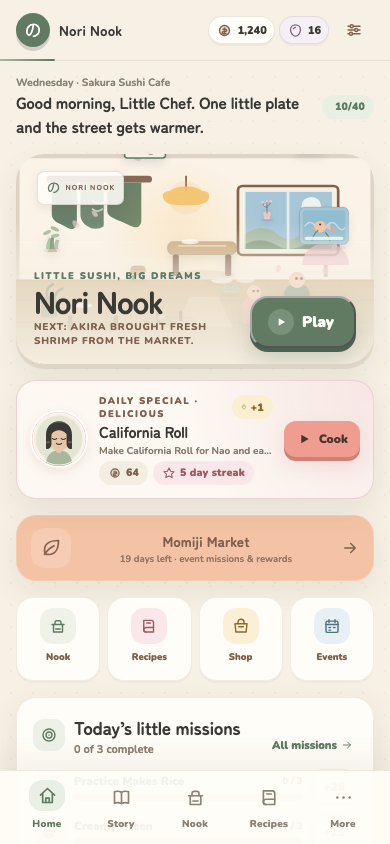
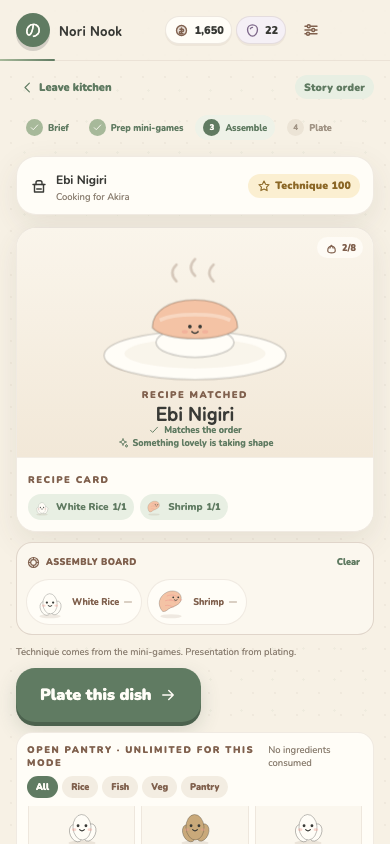
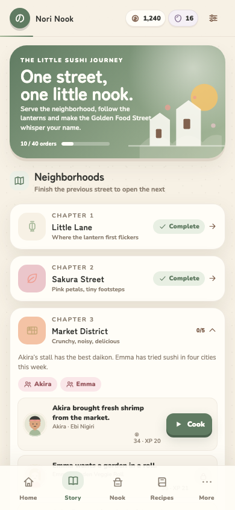
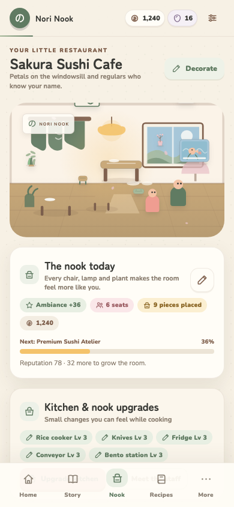
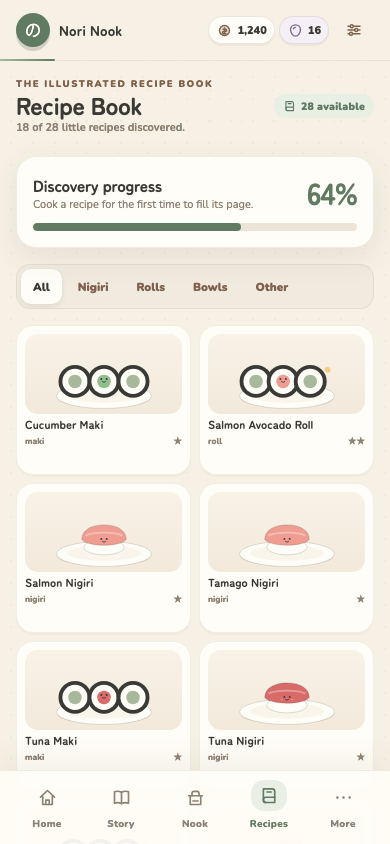
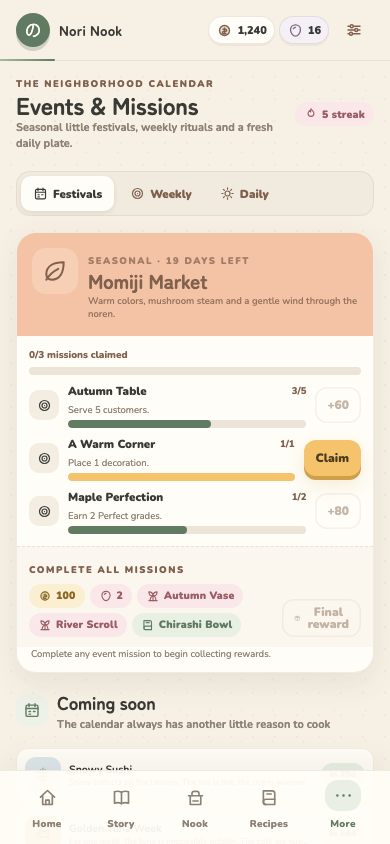
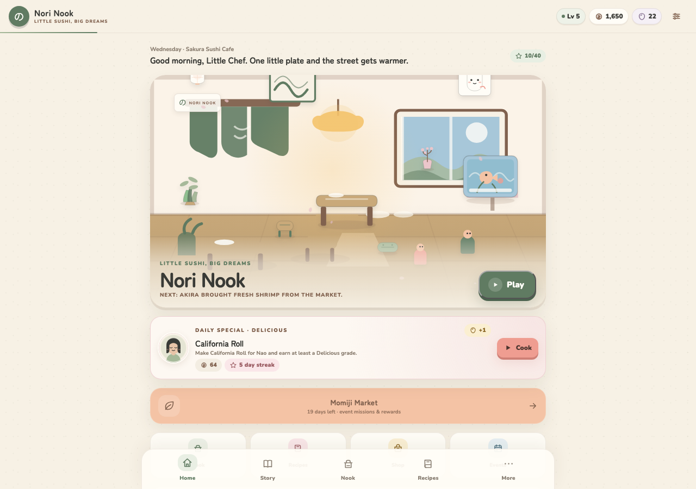

# NORI NOOK
### Little Sushi, Big Dreams.

Un gioco cozy completo, installabile come PWA, nel quale gestisci un piccolo ristorante di sushi in una tranquilla strada giapponese. Prepara sushi combinando ingredienti, affronta mini-giochi di cucina, servi clienti abituali, decora il locale, scopri ricette e fai crescere il tuo quartiere.

L'interfaccia di gioco è in inglese, coerentemente con i nomi originali di piatti, personaggi e modalità. Questa documentazione è in italiano.



---

## Caratteristiche principali

- **Sushi making reale**: ingredienti trascinabili, assemblaggio, quantità, impiattamento, ricette guidate e creazioni libere.
- **12 mini-giochi** brevi e rigiocabili, con punteggi deterministici e modalità rilassata.
- **10 modalità di gioco** operative: Story, Zen Kitchen, Lunch Rush, Sushi Puzzle, Sushi Merge, Daily Special, Delivery Dash, Sushi Chef Challenge, Creative Studio, Endless Restaurant.
- **34 ingredienti** illustrati, **28 ricette**, premium e stagionali.
- **8 quartieri** e **40 ordini storia** con clienti ricorrenti, amicizia, allergie e dialoghi.
- **50 livelli puzzle** con vincoli verificati e soluzioni validate.
- **14 clienti** (inclusi VIP e misterioso), **5 chef rivali**, **5 membri dello staff**.
- **10 upgrade** a 3 livelli e **33 decorazioni** in 8 stili.
- **19 achievement**, missioni giornaliere, settimanali ed eventi.
- **4 eventi stagionali + 10 eventi tematici**, calendario offline e ricompense persistenti.
- **Grafica SVG originale**, animazioni CSS, particellari leggeri e palette pastello giapponese.
- **Audio generativo originale** con Web Audio API: musica lo-fi e effetti sintetizzati.
- **PWA offline-first** con IndexedDB, autosave, versioning, migrazioni, backup/ripristino.
- **95 test unitari** e **14 test end-to-end Playwright** (al momento della consegna).

## Screenshot

| Cucina | Storia |
| --- | --- |
|  |  |

| Ristorante | Ricettario |
| --- | --- |
|  |  |

| Eventi | Desktop |
| --- | --- |
|  |  |

Gli screenshot vengono generati automaticamente da `tests/e2e/screenshots.spec.ts`.

---

## Stack tecnologico

- **React 19 + TypeScript + Vite 8**
- **Phaser 3** per il mini-gioco Canvas *Perfect Slice* (caricamento lazy)
- **React + SVG + CSS** per il resto dell'interfaccia, delle illustrazioni e dei mini-giochi
- **Zustand + Immer** per lo stato di gioco
- **Zod** per la validazione dei salvataggi e dei dati importati
- **Dexie / IndexedDB** per il salvataggio, la galleria e i backup
- **vite-plugin-pwa + Workbox** per manifest, service worker e cache offline
- **Web Audio API** per musica e effetti generati a runtime
- **Vitest + Testing Library + fake-indexeddb** per i test unitari
- **Playwright** per i flussi reali nel browser e per gli screenshot
- Font locali con licenza SIL OFL tramite Fontsource: **Nunito** e **Zen Maru Gothic**

Nessuna API key, nessun backend e nessun servizio esterno sono richiesti per giocare. La sincronizzazione cloud è predisposta come adapter futuro ma non è attiva.

---

## Installazione e avvio

Requisiti consigliati:

- **Node.js 22+** (testato con Node 25.9)
- npm 10+
- Per i test E2E: Chromium installato da Playwright

```bash
cd nori-nook-pwa
npm install
npm run dev
```

Il server di sviluppo apre normalmente su `http://localhost:5173`.

Se vedi errori come `Failed to load resource: 404` per `/src/main.tsx`, `/icon.svg` o i favicon, stai servendo la cartella sbagliata (spesso con Live Server sulla radice della repository) oppure stai aprendo il file sorgente senza Vite. In quel caso interrompi quel server e usa `npm run dev`; non serve alcuna configurazione aggiuntiva.

Per una verifica della build di produzione:

```bash
npm run build
npm run preview
```

La cartella `dist/` prodotta da `npm run build` può anche essere servita da un qualsiasi server statico, purché sia la **radice** del server e il gioco sia raggiungibile da `/`.

### Comandi

```bash
npm install
npm run dev
npm run typecheck
npm run test
npm run build
npm run preview
npm run test:e2e
npm run icons
```

- `npm run typecheck`: TypeScript strict, nessun errore atteso.
- `npm run test`: test unitari Vitest.
- `npm run build`: typecheck + build di produzione e generazione service worker.
- `npm run test:e2e`: build E2E + preview + Playwright. Richiede una volta `npx playwright install chromium`.
- `npm run icons`: rigenera le icone PWA dai file SVG in `public/`.

---

## Architettura

```text
nori-nook-pwa/
├─ public/
│  ├─ icon.svg
│  ├─ icon-maskable.svg
│  ├─ pwa-192x192.png
│  ├─ pwa-512x512.png
│  ├─ pwa-maskable-512x512.png
│  ├─ apple-touch-icon.png
│  ├─ favicon-16x16.png
│  ├─ favicon-32x32.png
│  └─ screenshots/                  # screenshot dichiarati nel manifest
├─ src/
│  ├─ app/
│  │  ├─ screens/                   # Home, Story, Kitchen, Shop, Events, ...
│  │  ├─ store.ts                   # stato Zustand, sessioni, run, missioni
│  │  ├─ router.ts                  # router hash interno
│  │  ├─ prefs.ts                   # preferenze localStorage
│  │  ├─ useAutosave.ts
│  │  └─ useAudioSync.ts
│  ├─ components/
│  │  ├─ art/                       # IngredientArt, SushiArt, volti, locale
│  │  ├─ game/                      # SushiBuilder, PlateBoard, ResultModal
│  │  └─ ui/                        # design system, HUD, nav, toast
│  ├─ game/
│  │  ├─ engine/                    # (predisposto) utility di gioco
│  │  ├─ sushi-making/              # matching ricette, grading, freeform
│  │  ├─ ingredient-system/         # inventario, freschezza, capacità
│  │  ├─ mini-games/                # MiniGameHost, scoring puro, giochi React/Phaser
│  │  ├─ restaurant/                # upgrade, decorazioni, staff, tier
│  │  ├─ customers/                 # generazione ordini, allergie, preferenze
│  │  ├─ economy/                   # ricompense, completamento ordini
│  │  ├─ progression/               # livelli XP, achievement
│  │  ├─ events/                    # calendario, daily deterministico
│  │  ├─ missions/                  # missioni giornaliere/settimanali
│  │  ├─ puzzles/                   # valutazione livelli puzzle
│  │  ├─ merge/                     # regole e board di Sushi Merge
│  │  └─ story/                     # progressione quartieri
│  ├─ data/                         # contenuti data-driven e tipizzati
│  ├─ storage/                      # Dexie, schema Zod, migrazioni, export/import
│  ├─ pwa/                          # install prompt, service worker UX
│  ├─ audio/                        # engine Web Audio
│  ├─ styles/                       # token, base, UI, schermate, mini-giochi
│  ├─ utils/                        # RNG seed, date, canvas, formattazione
│  └─ types/                        # tipi condivisi
├─ tests/
│  ├─ unit/                         # 95 test Vitest
│  └─ e2e/                          # 14 test Playwright + screenshot
├─ docs/screenshots/
├─ scripts/generate-icons.mjs
├─ vite.config.ts
├─ vitest.config.ts
├─ playwright.config.ts
├─ .env.example
└─ README.md
```

### Flusso del core loop

1. `Home` → `Play` apre il prossimo ordine della storia.
2. `KitchenScreen` mostra il brief e i mini-giochi richiesti.
3. Gli ingredienti vengono scelti dal pantry, trascinati sul board o toccati.
4. Il piatto viene impiattato in `PlateBoard`.
5. `gradeDish` calcola Presentation, Ingredient Match, Freshness, Technique e Order Accuracy.
6. `completeOrder` aggiorna coins, XP, reputazione, amicizia, missioni, eventi, achievement, ricette scoperte e stato della storia.
7. L'autosave scrive su IndexedDB e l'ordine successivo si sblocca.

---

## Modalità

| Modalità | Cosa offre |
| --- | --- |
| **The Little Sushi Journey** | 8 quartieri, 40 ordini, clienti, dialoghi, sblocchi e finale |
| **Zen Kitchen** | cucina libera senza timer, pantry infinito, scoperta ricette e pratica mini-giochi |
| **Lunch Rush** | 75+ secondi, coda di ordini, combo, punteggio e classifica locale |
| **Sushi Puzzle** | 50 livelli con vincoli, stelle, suggerimenti impliciti e soluzioni validate |
| **Sushi Merge** | board 6×6, regole esplicite, combo, Golden/Rainbow/Giant/Mystery, classifica locale |
| **Daily Special** | ricetta, cliente, mini-gioco e target deterministici per data |
| **Delivery Dash** | 3 consegne, timer, packing bento e bonus Bento Station |
| **Sushi Chef Challenge** | 5 chef, ricetta forzata, ingredienti limitati, timer e giuria |
| **Creative Studio** | composizione libera, sfondi, decorazioni, foto PNG e galleria |
| **Endless Restaurant** | servizio continuo, cuori, moltiplicatore, punteggio e classifica locale |

Tutte le modalità sono raggiungibili dalla Home o da **More**; nessun pulsante porta a una schermata vuota.

### Controlli

- **Mouse**: click, drag-and-drop degli ingredienti, dei sushi, delle decorazioni e dei piatti.
- **Touch**: gli stessi controlli con pointer events e `touch-action` per evitare scroll indesiderati.
- **Keyboard**: navigazione e attivazione dei pulsanti, Space/Enter per le azioni principali; ogni mini-gioco ha un pulsante **Skip** accessibile.
- Le impostazioni includono **Relaxed mini-games**, **Reduce motion**, volumi separati e disattivazione musica/SFX.

---

## Sistema ricette e sushi making

Le ricette sono definite in `src/data/recipes.ts` e validate in `src/game/sushi-making/match.ts`.

```ts
{
  id: 'salmon_nigiri',
  name: 'Salmon Nigiri',
  category: 'nigiri',
  ingredients: [
    { id: 'rice_white', qty: 1 },
    { id: 'salmon', qty: 1 }
  ],
  difficulty: 1,
  baseReward: 16,
  requiredMiniGames: ['perfect_rice', 'perfect_slice', 'nigiri_master'],
  unlockLevel: 1,
  description: 'A soft rice pillow with a blanket of salmon.',
  tags: ['fish', 'salmon', 'classic']
}
```

- Il matching canonico confronta l'insieme normalizzato di ingredienti e quantità.
- Una combinazione valida scoperta per la prima volta aggiunge la ricetta al ricettario, paga una ricompensa e mostra una notifica.
- Le combinazioni non riconosciute producono piatti **freeform** con nomi divertenti (per esempio *Tearful Wasabi Surprise*), senza bloccare il gioco.
- La valutazione usa cinque componenti e produce un grado: Normal, Good, Delicious, Perfect, Masterpiece.
- Le ricette possono includere ingredienti premium, stagionali e condimenti.
- La freschezza scende solo quando un ingrediente viene usato, mai per il tempo trascorso offline; un pavimento minimo evita di rendere gli ingredienti inutilizzabili.

### Aggiungere un ingrediente

1. Aggiungi una voce a `src/data/ingredients.ts`.
2. Scegli un valore `art` esistente o aggiungi un nuovo ramo in `src/components/art/IngredientArt.tsx` (e nell'export canvas in `src/utils/canvas.ts` se vuoi vederlo nelle foto).
3. Se serve, aggiorna prezzi, tag, stagionalità, livello di sblocco e test di contenuto.

```ts
{
  id: 'shiso',
  name: 'Shiso Leaf',
  category: 'vegetable',
  price: 4,
  quality: 3,
  rarity: 2,
  perishable: true,
  premium: false,
  color: '#8FBF8F',
  accent: '#607B62',
  art: 'leaf',
  tags: ['green', 'garnish', 'spring'],
  unlockLevel: 2,
  description: 'A bright little leaf with a peppery whisper.'
}
```

### Aggiungere una ricetta

Aggiungi un oggetto a `src/data/recipes.ts` con ingredienti esistenti e mini-giochi esistenti. Il test `validateContent()` controlla automaticamente riferimenti e difficoltà.

---

## Mini-giochi

I 12 mini-giochi sono:

1. Perfect Rice
2. Rice Cooker
3. Fan the Rice
4. Perfect Slice
5. Nori Wrap
6. Roll Master
7. Nigiri Master
8. Wasabi Balance
9. Plate Art
10. Quick Service
11. Tea Master
12. Delivery Pack

- **Scoring puro**: `src/game/mini-games/scoring.ts`; tutti i punteggi sono testati.
- **Host**: `src/game/mini-games/MiniGameHost.tsx`, con risultato, bonus, modalità relax e skip accessibile.
- **Phaser 3**: `PerfectSliceGame.tsx` usa una scena Phaser reale su canvas, caricata solo quando necessaria.
- **React/SVG**: gli altri mini-giochi usano componenti React dedicati, pienamente utilizzabili con touch e mouse.

Per aggiungere un mini-gioco:

1. Definisci un `MiniGameId` e i metadati in `src/data/miniGames.ts`.
2. Aggiungi una funzione di scoring pura in `scoring.ts` e i relativi test.
3. Crea il componente in `src/game/mini-games/reactGames/` (o una scena Phaser).
4. Registralo in `components` dentro `MiniGameHost.tsx`.
5. Aggiungilo alle ricette o alle modalità che devono usarlo.

---

## Eventi

Gli eventi sono dati in `src/data/events.ts`, con finestre annuali, missioni, ricompense, decorazioni e ricette. Il motore:

- calcola gli eventi attivi per data, incluse finestre che attraversano l'anno (Winter);
- salva progressi e claim in `save.events`;
- supporta eventi stagionali e tematici;
- calcola il **Daily Special** in modo deterministico dalla data;
- funziona completamente offline.

Per aggiungere un evento:

```ts
{
  id: 'mini_matsuri',
  name: 'Mini Matsuri',
  description: 'A tiny festival with paper lanterns and too much rice.',
  type: 'themed',
  startMonth: 11,
  startDay: 1,
  endMonth: 11,
  endDay: 7,
  missions: [/* Mission[] */],
  rewardCoins: 100,
  rewardPearls: 2,
  decorationIds: ['lamp_paper'],
  recipeIds: ['onigiri'],
  color: '#F4C3A5',
  accent: '#80614E',
  icon: 'lantern'
}
```

---

## Clienti, allergie e amicizia

I clienti sono definiti in `src/data/customers.ts`.

```ts
{
  id: 'haru',
  name: 'Haru',
  personality: 'friendly',
  preferences: ['salmon', 'avocado', 'tamago'],
  dislikes: ['wasabi'],
  allergies: [],
  budget: 28,
  patience: 100,
  rewardMultiplier: 1.0
}
```

- Gli ordini generati escludono sempre le ricette con allergeni del cliente.
- Le allergie sono mostrate in modo esplicito e bloccano il servizio se l'ingrediente è nel piatto.
- Le preferenze aumentano la ricompensa; le antipatie la riducono senza rendere il piatto impossibile.
- L'amicizia sale servendo piatti; sblocca dialoghi, note e un regalo decorativo al livello 5.
- VIP e cliente misterioso hanno moltiplicatori e richieste speciali.

### Aggiungere un cliente

Aggiungi un oggetto a `src/data/customers.ts` e, se vuoi farlo comparire in una storia, inseriscilo in un ordine di `src/data/story.ts`. I test di contenuto verificano preferenze, allergie e regali.

---

## Decorazioni e ristorante

- 33 decorazioni in 8 stili, con categoria, prezzo, rarità, dimensioni, ambiance e livello di sblocco.
- Le decorazioni acquistate si accumulano in storage; quelle piazzate possono essere trascinate, selezionate, ruotate e riposte.
- L'ambiance influenza le mance e il benessere del locale.
- Il ristorante ha 5 livelli visivi, da *Tiny Sushi Corner* a *Nori Nook Grand Restaurant*, determinati dalla reputazione.
- Gli upgrade hanno effetti reali: capacità, freschezza, finestre di timing, tagli, coda Rush, slot ordini, pazienza/Endless, reward e Delivery.

Per aggiungere una decorazione, inserisci un oggetto in `src/data/decorations.ts` e aggiungi l'art corrispondente in `src/components/art/DecorArt.tsx`.

---

## Salvataggi e offline

- Il salvataggio principale è in **IndexedDB** (`nori-nook`, store `saves`, chiave `main`).
- Le preferenze audio/accessibilità usano `localStorage`.
- Autosave con debounce; i completamenti di ordini, puzzle e merge vengono persistiti immediatamente.
- Schema di salvataggio **v2** con validazione Zod e migrazione da v1.
- In caso di salvataggio corrotto viene creata una copia di backup in `meta` e il gioco propone un nuovo salvataggio.
- La galleria delle foto è separata nello store `gallery`.
- Export/import JSON da **Settings**. Il backup non include le immagini della galleria.
- Il gioco funziona offline dopo il primo caricamento; test automatico Playwright incluso.
- La sincronizzazione cloud non è attiva. `src/storage/cloudSync.ts` e `.env.example` predispongono un adapter futuro.

### Installare la PWA

**Android / Desktop Chromium**

1. Apri il gioco da HTTPS (o `localhost`).
2. Usa il pulsante **Install Nori Nook** in Settings oppure il menu del browser → *Install app* / *Add to Home screen*.
3. Apri l'app dalla home; dopo il primo caricamento funziona offline.

**iOS / Safari**

1. Apri con Safari.
2. Tocca **Share**.
3. Seleziona **Add to Home Screen**.
4. Conferma **Add**.

La guida è disponibile anche in-app dalla sezione Settings.

---

## Accessibilità

- Controlli di dimensioni adeguate e aree touch generose.
- Pulsanti con label ARIA e focus visibile.
- **Reduce motion** e rispetto di `prefers-reduced-motion`.
- **Relaxed mini-games**: nessuna pressione temporale, finestre più ampie.
- Pulsante **Skip with a Good score** in ogni mini-gioco.
- Colore mai unico indicatore: icone, etichette e pattern accompagnano le informazioni.
- Volumi separati e toggle per musica/SFX.
- Tutorial interattivo saltabile e riproducibile.
- Testi e contrasto verificati sulla palette.

---

## Test e qualità

```bash
npm run typecheck
npm run test
npm run build
npx playwright install chromium   # una tantum
npm run test:e2e
```

Copertura dei test unitari:

- matching e validazione ricette;
- ingredienti, quantità, capacità e freschezza;
- grading e reward formula;
- progressione XP e achievement;
- salvataggio/caricamento, export/import, migrazione v1→v2 e backup corrotto;
- missioni giornaliere/settimanali e claim;
- eventi, daily deterministico e streak;
- generazione ordini e sicurezza allergie;
- decorazioni, acquisti, upgrade, staff e tier;
- completamento ordini, ricette scoperte, eventi e daily;
- scoring di tutti i 12 mini-giochi;
- validazione di tutti i 50 livelli puzzle e delle soluzioni;
- merge rules e coerenza dei contenuti.

Test E2E:

- tutorial → primo ordine → mini-giochi → impiattamento → servizio → ricompensa → reload;
- persistenza di shop, decorazioni e foto;
- puzzle giocabile e stelle;
- mount e scoring di tutti i 12 mini-giochi;
- Zen con scoperta ricetta;
- Lunch Rush completo;
- tutte le modalità avviabili;
- completamento Chef Challenge e Daily Special;
- manifest, service worker e funzionamento offline;
- generazione degli screenshot di documentazione.

Gli screenshot in `docs/screenshots/` sono prodotti dal test E2E e utilizzati in questo README.

### QA manuale consigliata

1. Cancellare i dati del sito e avviare un nuovo gioco.
2. Completare il tutorial e il primo ordine.
3. Giocare ogni mini-gioco in Zen.
4. Comprare un ingrediente, un upgrade, una decorazione e assumere uno staff member.
5. Posizionare e riposizionare una decorazione, poi ricaricare.
6. Scoprire una ricetta e verificare il ricettario.
7. Completare il Daily Special e una missione evento.
8. Provare tutte le modalità dalla Home.
9. Ricaricare e verificare che monete, ricette, amici e locale siano intatti.
10. Installare la PWA, attivare offline e riaprirla.

---

## Scelte di bilanciamento

- Nessun timer punitivo nella storia, in Zen, nei puzzle o nel Creative Studio.
- La storia usa un pantry fornito: il giocatore non può restare bloccato da un ingrediente mancante.
- Rush, Delivery ed Endless sono le modalità consuma-ingredienti e hanno timer scelti esplicitamente.
- Le ricompense crescono con grado, preferenze, amicizia, ambiance e staff, ma nessun acquisto è obbligatorio.
- Nessuna energia, nessuna attesa artificiale, nessuna monetizzazione.
- La freschezza non si deteriora offline.
- Il grado basso non fa perdere il piatto o i progressi; riduce soltanto la ricompensa.
- I puzzle sono rigiocabili e le stelle migliori vengono conservate.

---

## Limiti attuali e sviluppi futuri

- UI di gioco in inglese; il README è in italiano.
- Nessun backend, account o classifica online: le leaderboard sono locali.
- Cloud sync predisposta ma non attiva.
- L'export JSON non include le immagini della galleria.
- Il gioco è progettato per essere servito dalla radice del dominio; per un deploy in sottocartella è sufficiente adattare `base` di Vite e il manifest.
- Alcune espansioni future possibili: costumi, notifiche locali, più quartieri, fotogrammi condivisibili, sincronizzazione Supabase opzionale.

---

## Criteri di accettazione

- [x] Progetto indipendente in `nori-nook-pwa/`.
- [x] Gioco avviabile nel browser.
- [x] PWA installabile con manifest, icone, service worker e offline.
- [x] Design minimal cozy coerente.
- [x] Home illustrata e interattiva.
- [x] Ristorante illustrato con decorazioni salvate.
- [x] Ingredienti trascinabili e combinabili.
- [x] Ricette validate e scoperta.
- [x] 28 ricette reali e combinazioni libere.
- [x] 12 mini-giochi giocabili.
- [x] Clienti interattivi, ordini, allergie e amicizia.
- [x] Monete, stelle/XP, perle e ricompense.
- [x] Ricettario con silhouettes.
- [x] Inventario, shop e freschezza.
- [x] Decorazione del locale.
- [x] Autosave, backup, import e migrazioni.
- [x] Ripristino dopo reload.
- [x] Modalità offline dopo il primo caricamento.
- [x] Interfaccia mobile-first responsive.
- [x] Build di produzione.
- [x] Test automatici unitari ed E2E.
- [x] 8 quartieri, 50 puzzle, eventi e 10 modalità.

---

## Crediti

- Illustrazioni SVG, interfaccia, personaggi, ingredienti e sushi: realizzati originalmente per questo progetto.
- Musica e SFX: sintetizzati a runtime con Web Audio API; nessuna traccia commerciale.
- Font: **Nunito** e **Zen Maru Gothic**, distribuiti con licenza SIL Open Font License tramite Fontsource.
- Phaser 3, React, Vite e le altre librerie open source mantengono le rispettive licenze.

Nori Nook non contiene pubblicità, acquisti in-app, tracker o chiamate di rete necessarie al gioco.
