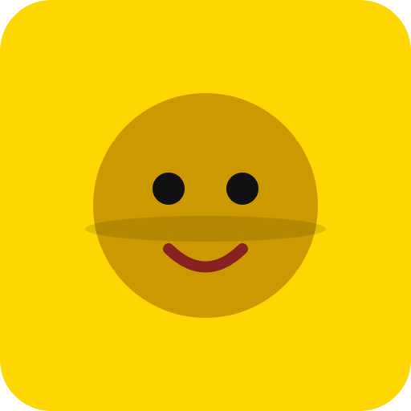

<div align="center">



# 🟨 STICKER SQUAD 🟨

### *"Be flat. Be fearless."*

**The 3D platformer where YOU are a sticker.**

Peel. Stick. Command. Conquer.

[](#-play-right-now)
[](#-the-five-worlds)
[](#-install-it-everywhere)
[](#-tech-specs)

</div>

---

## 🎬 Wait, what is this game?

> One drop of glitter-glue. One boring bedroom. One sticker that woke up **alive**.

You are **Glitch** 💛 — a golden sticker who peeled himself off the sheet and decided reality was boring. Your mission: recruit every lost sticker in the house, explore five impossible worlds hiding in plain sight, and defeat the ancient enemy of all stickers...

**The Dryer Sheet Ghost** 👻 *(he just wants everyone to be flat and static-free. Horrifying.)*

Your superpower? **You're flat.** Which means:

🧲 **STICK** to walls, ceilings, book spines — any surface, any angle
🌀 **PEEL** off with a satisfying *schlllp* and a mid-air curl
👥 **COMMAND** a squad of recruited stickers who follow you into danger
🎨 **SLAP** decal stickers onto the world — they're not decoration, they're *tools*
👻 **FIGHT** a dryer sheet that has never known fear... until now

---

## 🎯 The 10-Second Pitch

> *"It's like if a Post-it Note escaped your desk, hired three friends, and went on a low-poly adventure through your bedroom — wall-crawling included."*

## 🎯 The Pitch for a 5-Year-Old

> *"You know stickers? Imagine you ARE the sticker. You can stick on walls and ceilings, jump off like a superhero, and your friends are stickers too. There's a bad ghost made of dryer sheets. You have to beat him. Also you collect sparkly things."*

## 🎯 The Pitch for an Investor

> *"A premium mobile platformer with a zero-build web prototype that's already playable in any browser. One-hand portrait controls, sub-120KB core footprint, offline-first PWA, TikTok-native photo mode planned. The sticker aesthetic is merchandisable from day one — the merch IS the game IP."*

---

## 🌍 The Five Worlds

<div align="center">

| | World | The Hook | The Danger |
|---|-------|----------|------------|
| 🖊️ | **THE DESK** | Pencil bridges, eraser hills, tape-dispenser towers | Falling off the edge... into the carpet void |
| 📚 | **THE BOOKSHELF** | Scale vertical book fortresses spine-by-spine | Swinging bookmark tassels. They *sway.* You *fall.* |
| 🧱 | **THE FLOOR** | LEGO archipelagos and a carpet jungle at sticker scale | Dust bunnies. They bounce. They *hunt.* |
| 🪟 | **THE WINDOW** | Slippery glass, raindrop races, clouds below you | Raindrops slide you toward the frame. Don't let go. |
| 🎒 | **THE BACKPACK** | A dark crumpled-paper maze lit by flashlight beams | 👻 **THE DRYER SHEET GHOST.** He floats. He follows. |

</div>

Every world: **10 glitter stickers to collect** • **recruits to find** • **a portal to unlock** • **its own color palette, fog, and lighting mood**

---

## 👥 Meet the Squad

| Character | Who They Are | Fun Fact |
|-----------|-------------|----------|
| 💛 **GLITCH** | The hero. A sticker who refused to stay flat. | Named after the smudge on his left eye. He's proud of it. |
| 💗 **BUBBLES** | First recruit. Found trapped under a mug. | Believes she's the leader. Nobody corrects her. |
| 💚 **STICKY** | Found on the ceiling. Refuses to come down. | Actually useful up there. He sees everything. |
| 💜 **SMUDGE** | A misprint. Half purple. Full attitude. | The Dryer Sheet Ghost is his *sworn nemesis.* Don't ask why. |
| 👻 **THE GHOST** | Boss. Ancient. Static-charged. | Believes all stickers must lie flat forever. Villain arc pending. |

---

## 🕹️ How to Play

### ⌨️ Desktop (today)
| Key | Action |
|-----|--------|
| `W A S D` / arrows | Move |
| `Space` | Jump — or **peel off a wall** with style |
| `Shift` | Sprint (sticker cardio) |
| `E` | Stick to the nearest wall |
| `Click` | Collect • Recruit • Attack • Place a decal |
| `Q` | "Squad, follow me!" |
| `1 2 3` | Pick your decal color |

### 📱 Mobile — ✅ Implemented in Phase 1
- **Left thumb** — floating analog joystick (spawns where you touch, speed scales with push)
- **Right thumb** — contextual Jump / Stick🧲↔Peel🌀 / Interact⭐🤝👻 buttons
- **Swipe up** while stuck — instant stylish peel
- **Drag** — orbit camera · **Pinch** — zoom (0.55×–1.9×) · **Double-tap** — reset view
- **Tap** — interact · **Buzz** on every stick, peel, collect and hit (haptics)
- **🔋 Battery saver** — auto 30fps + no shadows below 20% battery
- Rotate-to-landscape overlay, safe-area aware, fullscreen on first touch

---

## 📲 Install It Everywhere

It's a **PWA** — installable, offline, no app store needed:

<details>
<summary><b>📱 iPhone / iPad</b></summary>

1. Open the game in Safari
2. Share button → **Add to Home Screen**
3. Full screen. Offline. Icon on your home screen like magic.
</details>

<details>
<summary><b>🤖 Android</b></summary>

1. Open in Chrome
2. ⋮ menu → **Install app**
3. Done. It even gets its own splash screen.
</details>

<details>
<summary><b>💻 Desktop</b></summary>

1. Open in Chrome / Edge
2. Click the **⊕ Install** icon in the address bar
3. A dedicated game window pops out
</details>

### 🛠️ Run it locally
```bash
cd sticker-squad-pwa
python3 -m http.server 8080
# → http://localhost:8080
```
Any static server works. No build. No npm. No tears.

---

## 🏆 Why This Will Be Catchy

✅ **The one-sentence hook sells itself:** *"You're a sticker. Stick to walls."* — everyone gets it instantly
✅ **Peeling is ASMR.** The peel animation + sound is the "popcorn moment" people share
✅ **Squad mechanics = memes.** Three tiny stickers following you around is inherently funny
✅ **Worlds are relatable.** Everyone's had a bedroom. Everyone's feared the dust bunny
✅ **The ghost is a *dryer sheet.*** This will become a meme and we all know it
✅ **Merch-ready IP.** Real stickers, plushies, enamel pins — the game *is* the product
✅ **Screenshot bait.** Holographic skins + photo mode = infinite TikTok content

---

## 📸 Perfect for a Store Listing (Copy-Paste Ready)

**App Store Title:**
> Sticker Squad: Peel & Stick 3D

**App Store Subtitle:**
> Be flat. Be fearless.

**Description:**
> You woke up as a sticker. Bad news: the Dryer Sheet Ghost wants you flat. Good news: you can stick to ANYTHING.
>
> Peel off walls. Climb book fortresses. Outrun dust bunnies. Recruit a squad of fellow stickers and take back the bedroom — one satisfying *schllllp* at a time.
>
> ▶ STICK to walls, ceilings & book spines
> ▶ PEEL off with a curl and a *thwump*
> ▶ COMMAND up to 3 squad stickers
> ▶ DEFEAT the legendary Dryer Sheet Ghost
> ▶ EXPLORE 5 handcrafted low-poly worlds
>
> No ads. No energy timers. Just stickers.

**Keywords:** `platformer, sticker, low poly, 3d, cute, squad, peel, kawaii, offline, kids`

---

## 🧱 Tech Specs

| | |
|---|---|
| **Engine** | Three.js r128 (CDN) |
| **Language** | Vanilla ES6+ — zero frameworks, zero build steps |
| **Physics** | Custom AABB + the world-rotation sticking trick 🧠 |
| **Audio** | 100% procedural Web Audio API — no sound files |
| **Size** | **~120KB** including Service Worker |
| **Offline** | Full PWA caching |
| **FPS target** | 60 on modern phones (30fps battery-saver mode planned) |

### 🧠 The Famous Sticking Trick™
When you stick to a wall, the game **rotates the entire world** so that wall becomes the new floor. Your jump/gravity/walk code never changes. No quaternion nightmares. One clever trick powers the whole game.

### 📂 Project Structure
```
sticker-squad-pwa/
├── index.html         # Shell + UI
├── style.css          # HUD & overlays
├── manifest.json      # PWA identity
├── sw.js              # Offline caching
├── js/
│   ├── main.js        # 🚀 Bootstrap
│   ├── engine.js      # 🎥 Scene, camera, geometry cache
│   ├── player.js      # 💛 Glitch: state machine + movement
│   ├── levels.js      # 🌍 All 5 world generators
│   ├── enemies.js     # 👻 Hazards + boss AI
│   ├── squad.js       # 👥 Recruitment & formations
│   ├── game.js        # 🎮 Update loop, camera, interaction
│   ├── particles.js   # ✨ Juice
│   ├── audio.js       # 🔊 Procedural SFX
│   └── ui.js          # 🖥️ HUD & screens
└── assets/            # 🎨 PWA icons
```

---

## 🗺️ The Road to Mobile Stardom

The full plan lives in **[TODO.md](TODO.md)** — 8 phases from this prototype to a shipped premium mobile game:

```
Phase 1  📱 Mobile MVP — touch controls, haptics, 60fps      ✅ DONE
Phase 2  🎨 Content Explosion — 6 new worlds, magic decals   ← WE ARE HERE
Phase 3  👤 Character & Customization — 20+ skins, rarity tiers
Phase 4  🌐 Multiplayer — co-op, Sticker Tag, ghost horror mode
Phase 5  🏗️ Level Editor — build-a-bedroom, shareable codes
Phase 6  📸 Photo Mode & TikTok export
Phase 7  💰 Ethical Monetization — premium, zero dark patterns
Phase 8  🚀 App Store Launch — Capacitor, achievements, cloud saves
```

---

<div align="center">

## 🟨 Peel. Stick. Command. Conquer. 🟨

**⭐ Star this repo if a sticker has ever brought you joy ⭐**

<i>Built with glitter, caffeine, and zero build tools.</i>

</div>
