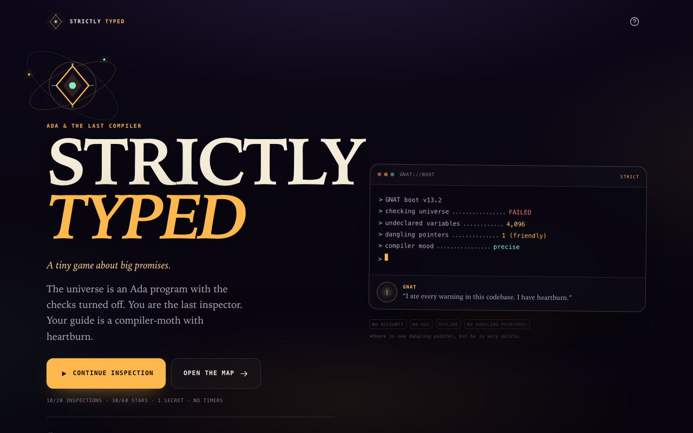

# STRICTLY TYPED

### Ada & the Last Compiler

> The universe is an Ada program with the checks turned off.
> You are the last inspector. Your guide is a compiler-moth with heartburn.

**A tiny game about big promises.** Learn Ada through a 20-step campaign — fifteen lessons and five boss audits —
plus twenty philosophical field notes and four endings, one of which is not on
the audit form.

**Play:** <https://lucagandolfi77.github.io/random2/strictly-typed-pwa/>



## What it is

A mobile-first, offline-first learning game. There is no code editor and no
WASM compiler: each level is a **rite**, a small program whose lines have been
shuffled. Tap the lines in the order Ada would accept. The compiler is a
character; mistakes are diagnostics, not game overs.

- Five chapters and twenty nodes: fifteen lessons and five boss audits. A full
  campaign is roughly 35 minutes.
- **Real Ada 2012 snippets**, hand-reviewed. The browser simulates each
  program's output; it does not compile the code.
- **A Codex** with every concept in plain English, the real syntax, common
  mistakes, a cheat sheet and a glossary.
- **The Book of Declarations**: 20 collectible Field Notes and four endings.
- **Five bosses**: The Null, Constraint Error, Randy (uninitialized), Segfault
  (who lost his address) and The Compiler.
- **No timers, no energy, no ads, no accounts, no analytics.** Sound and haptics
  are optional; `prefers-reduced-motion` is respected.
- **Installable PWA**: the entire campaign is precached and playable offline.

## The chapters

| Chapter | Lessons | Boss |
| --- | --- | --- |
| I · The Void Compiles | Hello, World; variables and constants; types and subtypes | **The Null** |
| II · The House of Promises | conditionals; case and enumerations; loops | **Constraint Error** |
| III · The Hermit's Package | arrays; functions; package specification and body | **Randy, Uninitialized** |
| IV · The Forbidden Heap | records; access types; exceptions | **Segfault** |
| V · The Root Type | generics; tasks; pre/post contracts | **The Compiler** |

The finale asks what the recompiled universe should optimize for: safety,
freedom, or attention. Collect all twenty fragments to meet the fourth answer.

## Controls

- **Tap** a code line to place it. There is one canonical order. No typing.
- **Hint** reveals the next line's location and costs stars, not dignity.
- **Boss audits**: find the faulty line, choose the fix, or predict the output.
  A wrong answer costs one of three hearts and reveals the explanation.
- Everything is keyboard-accessible; the story's typewriter can be skipped with
  **Reveal all** or a tap.

Stars: three for no mistakes and no hints; two for a little help; one for
getting there.

## Run it

No build step and no dependencies. Serve the repository root with any static
server:

```sh
python3 -m http.server 8099
# open http://localhost:8099/strictly-typed-pwa/
```

Opening `index.html` directly with `file://` will load the game but service
workers and installation need `http://localhost` or HTTPS.

## Test it

```sh
cd strictly-typed-pwa
npm test                         # node:test: content, puzzle, state invariants
node smoke.mjs                   # in-browser Chromium checks, skips if no Chromium
```

The smoke test expects a server at the URL above (pass an alternate URL as the
first argument). It covers the title, prologue, a full rite, hints and mistakes,
a boss failure and retry, a boss victory, the secret ending, installability,
320px layout and an offline reload.

Visual assets can be regenerated with:

```sh
node strictly-typed-pwa/scripts/gen-icons.mjs
node strictly-typed-pwa/scripts/gen-assets.mjs
```

`gen-assets.mjs` captures the manifest screenshots and `og-cover.png` from the
running app. It uses `tools/cdp.mjs` and Chromium, with no extra dependencies.

## Structure

```text
strictly-typed-pwa/
  index.html            shell, meta, inline SVG icon sprite
  styles.css            design system, screens, responsive layout
  manifest.json         installable PWA, shortcuts, screenshots
  service-worker.js     precache + offline navigation
  icons/                SVG and generated PNG icons
  shots/                install screenshots
  og-cover.png          social preview
  src/
    content.js          chapters, lessons, bosses, fragments, endings, codex
    state.js            versioned localStorage store (pure factory for tests)
    puzzle.js           seeded shuffles, star rules, boss answers, diagnostics
    audio.js            tiny WebAudio synth, no audio files
    art.js              all inline SVG art and character sigils
    ui.js               Ada highlighter, dialogue, modals, toasts, confetti
    app.js              hash router, screens, game flow, PWA wiring
  tests/                node:test suites
  scripts/              icon and screenshot generators
  smoke.mjs             Chromium smoke test
```

State lives under a single versioned key, `strictlyTyped.v1`. Corrupt or
impossible saves are repaired rather than fatal. Progress, settings and
collectibles never leave the device.

## Notes on Ada

- All lesson and boss snippets target Ada 2012 and were written to be legal
  (the deliberate bugs in boss audits aside). Where a level only builds a
  specification or a generic unit, the lesson and run output say so.
- `'Image`, `'Range`, `.all`, `exception … when … =>`, task bodies, generic
  formal types and pre/post aspects are all real Ada, not invented syntax.
- The moth is named GNAT after the GNU Ada compiler. It is an affectionate
  mascot, not a build tool, and has no access to your filesystem.
- Ada is named after Ada Lovelace. The protagonist's uninitialized initial is
  the least accurate thing about her.

## Credits

Design, writing, code and SVG art by Luca Gandolfi. Inspired by Ada Lovelace,
the GNU Ada compiler, strong typing, information hiding, and the strange
tenderness of a good error message.

No external fonts, images, frameworks or analytics. The whole game is HTML,
CSS and JavaScript.

> `-- end of file. begin again.`
